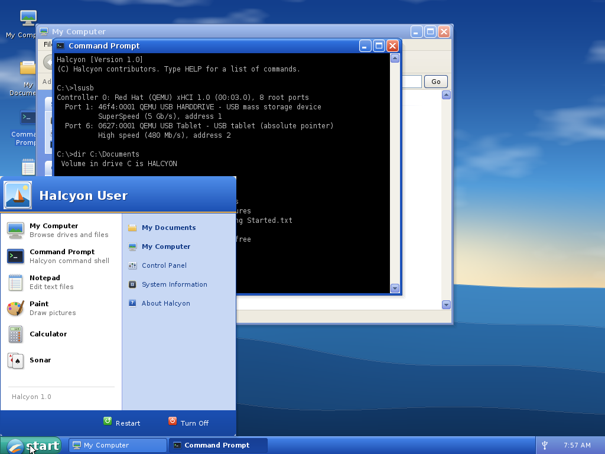

# Halcyon



Halcyon is a small x86-64 hobby operating system with an early-2000s style
desktop: glossy blue title bars, a Start menu, a taskbar with a clock, notification
balloons, and desktop icons. It boots from a USB stick on BIOS and UEFI PCs and has
its own drivers for USB, SATA and FAT file systems.

## Features

| Area | What's there |
|------|-------------|
| Boot | Custom MBR plus stage 2 for BIOS (unreal mode, reads `\HALCYON\KERNEL.BIN` from FAT32 via INT 13h), and a UEFI loader (`\EFI\BOOT\BOOTX64.EFI`, GOP framebuffer). One image boots both ways. |
| Kernel | 64-bit, identity mapped, TSC timing, PCI enumeration, ACPI S5 power-off, PS/2 keyboard and mouse. |
| Threads and programs | Kernel threads with a scheduler (copies, moves and deletes run in the background with a progress dialog and Cancel). Programs run in user mode in their own address space: static position-independent ELF64 `.EXE` files loaded from disk (`C:\PROGRAMS`), preempted every 10 ms, with threads (up to 32 per program; mutexes and condition variables on futexes), named shared memory, system calls for files, memory, processes, the console and windows (an early-2000s style window, drawing and controls API with menus, scroll bars, toolbars, status bars and direct access to the window's pixels), and BSD sockets: local stream and datagram sockets between programs, by name (back-pressure, non-blocking calls, timeouts, peers told when a program ends), and `poll` over sockets, files and the program's window events. Pages are no-execute unless they hold code; SMEP, SMAP and UMIP are on where the CPU has them. A program that crashes gets a "has encountered a problem and needs to close" dialog and takes nothing else down. Task Manager (Ctrl+Alt+Del) ends programs that hang; a program can end only programs it started, anything else needs your OK in a dialog of the system. Calculator, Sonar, Notepad, Paint and Explorer are user programs. |
| Interrupts | Local APIC (xAPIC or x2APIC) and I/O APICs from the ACPI MADT, or the 8259 PICs. MSI-X and MSI for xHCI and AHCI. PCI INTx for UHCI, OHCI and EHCI: without an AML interpreter the routing is learned from which device raised an interrupt. The CPU halts when there is nothing to do: a one-shot local APIC (or PIT) timer wakes it for the next deadline. A device whose interrupt does not work is polled. |
| USB | Host controllers: UHCI and OHCI (USB 1.1), EHCI (USB 2.0, with companion hand-off), and xHCI (USB 3.x, SuperSpeed). Class drivers: hubs (USB 2 and SuperSpeed), HID (report descriptor parsing, report protocol as on Windows, boot protocol as the fallback): keyboards including n-key rollover and wireless receivers with several devices on one interface, multimedia keys (volume, media, browser, mail, calculator, power and sleep), mice and tablets; and mass storage (Bulk-Only Transport plus SCSI). Hot-plug. |
| Network | Drivers for virtio-net (virtio 1.0 and legacy), Intel e1000 (8254x), e1000e (82574L; 82571/2/3/83 and the on-board I217/I218/I219 to spec), igb (82576; I350/I210/I211 to spec), Realtek RTL8139 and, to spec, RTL8169/8111/8168. MAC address, link state and speed, receive and transmit rings, MSI-X/MSI/INTx or polled, statistics; adapters, link and counters in System Information. |
| Storage | AHCI SATA (LBA48, multiple controllers). NVMe SSDs (MSI-X, MSI, INTx or polled; every active namespace with 512- or 4096-byte blocks becomes a disk, `nvme0`, `nvme1`, ...; flushed when the drive has a volatile cache, shutdown notification on Turn Off/Restart). CD/DVD drives on SATA (ATAPI): read-only drive letters, discs detected when inserted, ejected or swapped, Eject in the drive's right-click menu. Block layer with MBR (including extended partitions), GPT and superfloppy detection. |
| File systems | FAT12, FAT16 and FAT32, read and write: long file names, create, delete, rename and move, mkdir and rmdir, truncate, FSInfo. exFAT, read and write (USB sticks and SD cards over 32 GB): fragmented and contiguous files, ValidDataLength, the volume's up-case table for case-insensitive names, VolumeDirty handling. DOS drive letters; the boot drive is `C:`. Quick format (FAT12/16/32 and exFAT) from Explorer (right-click a drive) or the `FORMAT` command, with Windows' default cluster sizes. |
| CD/DVD | ISO 9660 with Joliet (long Unicode names) and Rock Ridge names, multi-sector directories and multi-extent files, hardened against corrupt discs. Hybrid ISO images written to USB sticks or disks mount too. |
| Keyboard | 20 layouts that follow Windows': US, US-International, UK, German, Swiss German, French, Belgian (AZERTY), Spanish, Italian, Portuguese, Brazilian (ABNT2), Swedish/Finnish, Norwegian, Danish, Dutch, Polish (Programmers), Czech, Turkish Q, Russian and Greek. AltGr (Right Alt, or Ctrl+Alt), dead keys (a dead key followed by a key it does not compose with gives the accent, then the key), Caps Lock per key, the ISO key next to left Shift and the ABNT2 keys. Ctrl shortcuts go by the letter on the key (Ctrl+A is the AZERTY "A"; US letters on Russian and Greek). Several layouts can be installed: Left Alt+Shift or the indicator on the taskbar switches; Keyboard settings in the Control Panel or the `KEYBOARD` command. Characters reach programs as Unicode code points. |
| Unicode | File names and text are UTF-8 throughout; FAT long names are stored as UTF-16 (including characters outside the BMP), with Unicode case-insensitive lookup. The fonts cover Latin, Greek, Cyrillic and common symbols; other characters are kept and drawn as a replacement box. |
| GUI | Compositing window manager (move, resize, minimize, maximize), menus, dialogs, widgets, three colour themes, four procedural wallpapers. Theme and wallpaper are kept across restarts (`C:\HALCYON\SETTINGS.INI`). |
| Display | The loaders read the monitor's EDID and start in its native resolution (a 4K panel gets an exact fraction such as 1920×1080, since the UI has no scaling), or in the resolution chosen in Display Properties. With the firmware frame buffer a new resolution applies at the next start; the QEMU/Bochs/VirtualBox adapter switches at once, with Windows' "keep these settings?" 15-second revert. The frame buffer is write-combining (PAT). |
| Web | A web browser (Web Browser, `BROWSER.EXE`): HTTP/1.1 and HTTPS, pages with headings, lists, tables, forms and PNG / GIF / BMP images, history, error pages, local files; `WGET.EXE` on the command line. HTTPS through BearSSL (TLS 1.2) with certificates checked against Mozilla's root list. Both are user programs on libweb, a library for URLs, HTTP, TLS and gzip. They need the internet stack of milestone 6 (in progress) to reach the network; local pages work now. See [docs/DESIGN-M6-WEB.md](docs/DESIGN-M6-WEB.md). |
| Apps | Explorer (My Computer, file management; copies and deletes in a worker thread), Web Browser, Notepad (UTF-8 text in any keyboard layout, files up to 16 MB), Command Prompt (DOS-style shell with redirection), System Information (device tree), Paint (BMP), Calculator, Sonar (a mine-hunting puzzle), Control Panel, Display Properties, Keyboard settings, About. |

## Building

You need gcc, binutils, nasm, clang and lld (for the UEFI loader), python3 with Pillow
(it renders fonts and icons at build time), sfdisk, mtools and dosfstools.

```bash
make
```

This produces `build/halcyon.img`, a 128 MiB disk image with an MBR partition table and
one bootable FAT32 partition. Files in `rootfs/` are copied onto it.

## Running in QEMU

```bash
tools/run.sh xhci bios
```

- First argument: the USB controller the stick is attached to. One of `uhci`, `ohci`,
  `ehci`, `ich9` (EHCI with UHCI companions) or `xhci`.
- Second argument: `bios` or `uefi` (OVMF).
- Extra QEMU options go in `EXTRA`, and a CPU model in `CPUARG` (e.g. `-cpu max`).
  For example, a SATA disk and a USB tablet:

```bash
EXTRA="-drive if=none,id=d0,format=raw,file=build/fat16.img -device ide-hd,drive=d0,bus=ide.0 -device usb-tablet,bus=usb.0" tools/run.sh xhci uefi
```

A network adapter on QEMU's user-mode network (the device can also be `e1000`,
`e1000e`, `igb` or `rtl8139`):

```bash
EXTRA="-netdev user,id=n0 -device virtio-net-pci,netdev=n0" tools/run.sh xhci bios
```

`make testdisks` builds sample FAT12, FAT16 and GPT/FAT32 images for testing.

## Writing it to a USB stick

**This erases the stick.** Replace `/dev/sdX` with your stick's device name
(check it with `lsblk`).

```bash
sudo dd if=build/halcyon.img of=/dev/sdX bs=4M conv=fsync status=progress
```

On Windows, use a raw image writer such as Rufus (in "DD image" mode) or balenaEtcher.
Then boot from the stick. On UEFI machines, turn off Secure Boot: the loader is not signed.

## Troubleshooting and testing on real PCs

- Press **F8** at the "Press F8 for Advanced Startup Options" prompt to open the
  advanced startup menu. It has verbose boot (the kernel log on screen), Safe Mode,
  switches that disable individual drivers (xHCI, EHCI, UHCI/OHCI, AHCI, ACPI),
  interrupt fallbacks (no interrupts at all, no MSI, legacy PIC instead of the I/O
  APIC), and an 800×600 safe video mode.
- The Command Prompt's `IRQ` command shows the interrupt mode, the timer, CPU usage
  and every interrupt source with its count. System Information shows the same under
  Computer → Interrupts.
- The kernel log is saved to `\HALCYON\BOOT.LOG` on the stick when the desktop
  starts, on shutdown or restart, and after a crash. The previous boot's log is kept
  as `BOOTPREV.LOG`.
- See [docs/HARDWARE.md](docs/HARDWARE.md) for the test checklist and the
  compatibility list.

## Tests

```bash
tools/ci.sh
```

This runs the following checks; `.github/workflows/ci.yml` runs the same script:

- a warning-free build
- the host keyboard layout test (`tests/host/kbdtest.c`): keys at every level,
  Caps Lock, AltGr, dead keys and shortcut letters of each layout, written from
  the Windows layouts independently of the tables, plus checks on every table
- the host USB HID tests (`tests/host/hidtest.c`, run first by `tests/host/run.sh`):
  the report descriptor parser and report decoder against QEMU's keyboard, mouse
  and tablet, an n-key-rollover gaming keyboard, a wireless receiver, media key
  interfaces and broken, truncated and randomly mutated descriptors
- the host storage test suite (`tests/host/run.sh`, about 110,000 checks): the
  FAT, exFAT and ISO 9660 drivers, Unicode names and formatting, compiled for the
  host with ASan/UBSan and run against images made by mkfs.fat, mkfs.exfat and
  xorriso. Results are cross-checked with mtools, `fsck.fat`, `fsck.exfat` and an
  independent exFAT implementation in Python (`tests/host/exfat_tool.py`), and
  a few hundred deliberately corrupted images plus the fuzzer's regression
  inputs must fail cleanly
- a QEMU boot matrix (`tools/boottest.py`) covering UHCI, OHCI, EHCI, EHCI with
  companions, and xHCI, under BIOS and UEFI, plus the interrupt fallbacks (legacy
  PIC, no MSI, no interrupts) set through a QEMU-only `fw_cfg` hook, NVMe disks
  (512- and 4096-byte blocks, INTx, polled), a CD drive with a disc swap, and
  network adapters (virtio-net in its three PCI forms, e1000, e1000e, igb and
  rtl8139: an ARP exchange with QEMU's gateway and a few thousand more frames
  through every ring, with MSI-X, INTx and polled), and
  user mode: `SELFTEST.EXE` runs after boot and checks the system calls, bad
  pointers, crashing and looping child programs, preemption and windows;
  `SOCKTEST.EXE` checks sockets and poll between copies of itself (large
  transfers, datagrams, timeouts, backlogs, peers that crash or are ended,
  per-program and system-wide limits); and
  the display: a saved resolution chosen by both loaders, the firmware frame
  buffer alone, and a live mode switch
- the EDID parser and the loaders' resolution choice (`tests/host/displaytest.c`)
- the web library and the browser's parser and decoders (`tests/web/run.sh`),
  built for Linux with ASan/UBSan: URLs, the CA list's conversion, inflate
  against Python's zlib/gzip and corrupt streams, PNG / GIF / BMP against
  Pillow, HTML and layout on mutated pages, and HTTP / HTTPS against local
  test servers with a test CA (bad certificates of every kind, broken
  answers, redirect loops, timeouts, limits); in QEMU, the `web` variant runs
  `WEBTEST.EXE` (TLS handshakes through BearSSL as built for Halcyon)

The partition, FAT, exFAT and ISO 9660 code can also be fuzzed with libFuzzer, ASan and UBSan
(needs clang and `libclang-rt-dev`):

```bash
make -C tests/host fuzz-run FUZZ_TIME=900 FUZZ_JOBS=2
```

Each boot must reach the desktop, mount the boot stick and a SATA disk, and write
`BOOT.LOG`. A USB keyboard and tablet sit on the controller under test: the
keyboard must run in report protocol, and Caps Lock sent through the QEMU
monitor must switch its LED on and off. With interrupts on, the stick's USB controller must get a working
interrupt and QEMU must use under 40% of a host CPU at the idle desktop (it uses
0–6%; 100% with interrupts off).

## Writing programs

Programs live in `userland/programs/*.c`, one file each, and use the API in
`userland/include/hal.h`: a small C library (strings, `printf`, `malloc`, files) and
windows with drawing calls, standard controls (buttons, text boxes, list boxes),
message boxes and file dialogs. `make` builds each into `build/user/NAME.exe` and
puts it on the image as `C:\PROGRAMS\NAME.EXE`. Type its name in the Command Prompt
(console output and input go to that window) or double-click it in Explorer.
`HELLO.EXE` is a console example; `CRASHME.EXE` (Crash Test) fails in nine
different ways on purpose; `TASKMGR.EXE` is Task Manager; `EXPLORER.EXE` is
Explorer (My Computer, folder views, copy / move / delete in a worker thread
behind a progress window; it opens files with `shell_open`, the shell's own
tools with `shell_app` and reads Properties details with `stat_ex`); `CALC.EXE` and
`SONAR.EXE` are full GUI programs (they draw into their own pixel buffer and
blit it, then add text). `NOTEPAD.EXE` is Notepad: menus, a scroll bar and a
status bar from the API below, the text drawn line by line and measured with
the local font metrics, a gap buffer so editing a file of several megabytes
stays fast; the shell starts it for text files. `PAINT.EXE` is Paint (the
desktop icon, the Start menu, `.bmp` files and the `PAINT` command start it):
menus, scroll bars and a status bar from the API, the picture drawn straight
into the window's mapped pixels (`win_canvas`), and a BMP reader that checks
every size and offset of the file. `SELFTEST.EXE` checks the
system calls (`selftest` in the Command Prompt; the QEMU `user` test variant
runs it). `GUIDEMO.EXE` (GUI Demo) uses every part of the window API below
and logs each event it gets.

The window API in `hal.h` (comments there give the details):

- **Windows and events:** `win_create` gives a window whose client area is a
  canvas kept in the kernel; `win_get_event` returns paint, close, key, mouse,
  wheel, resize, timer, focus, command (controls), `EVT_MENU` and `EVT_SCROLL`
  events. A press in the client area captures the mouse until the buttons are
  released (moves outside the window still arrive), and mouse events carry the
  modifier keys. `win_set_cursor` picks the pointer shape (arrow, I-beam,
  wait, crosshair, hand, resize arrows), `win_get_rect` gives the client area's
  place on screen, `win_set_min_size` the smallest size the user can drag it
  to, and `win_set_owner` makes a window a (modal) dialog of another one.
- **Menus:** `menu_set` gives a window a menu bar from a flat array of
  `hal_menu_item_t` (a `MENU_TITLE` entry starts each menu; items have an id,
  shortcut text, an icon, and separator, disabled, checked and bold flags;
  `&` marks mnemonics). The bar sits above the client area, so adding,
  replacing or removing it leaves the canvas and coordinates as they were.
  `menu_popup` shows a context menu at a client position, `menu_enable` /
  `menu_check` change items by id. F10 or a tap of Alt opens the menus from
  the keyboard; Alt+letter opens one, arrows, Enter and Esc work inside.
- **Drawing:** fills, lines, rectangles, circles, bevels, icons, pixel blits,
  text (`gfx_text`, `gfx_text_n` for text without a NUL, `gfx_text_box`
  with alignment and "..." when it does not fit), gradients and the rounded,
  sunken and shadowed shapes of the theme (`gfx_shade`), whose colours
  `gfx_theme` returns. `gfx_clip` / `gfx_clip_origin` limit drawing to a
  rectangle (and move the origin to it), e.g. to draw a text area next to the
  program's own scroll bars.
- **Text measurement without a system call per string:** `text_width`,
  `text_width_n`, `text_fit` and `text_char_width` measure locally from
  advance widths the library copies from the kernel once per font and block
  of 256 characters (`gfx_font_metrics`); `utf8_get` / `utf8_put` /
  `utf8_prev` walk UTF-8 text the way the kernel draws it.
- **Controls:** buttons, labels, text boxes, check boxes, list boxes, groups,
  progress bars, vertical and horizontal scroll bars (`ctl_scroll_set`: range,
  page, position and line step; arrows repeat while held, the track pages, the
  thumb drags and the wheel scrolls), flat tool bar buttons with an icon and a
  tooltip (`ctl_set_tool`), and a status bar docked at the bottom with
  tab-separated parts. `ctl_move` lays them out again after a resize,
  `ctl_focus` moves the keyboard between controls and the program's own
  drawing, and `CTL_NOTIFY` makes Enter in a text box (or a double click in a
  list box) send a command.
- **Dialogs and clipboard:** `msgbox`, `file_dialog`, `inputbox` (a one-line
  question), `clipboard_set_n` for text up to 1 MiB, `clipboard_get`.

Every call checks the program's pointers and bounds its work, and a window's
menus, controls and canvas go away with the window or the program.

Programs talk to each other through sockets (BSD calls: `socket`, `bind`,
`listen`, `accept`, `connect`, `send`/`recv`, `sendto`/`recvfrom`,
`shutdown`, `socketpair`, `setsockopt`, and `poll`; `read`, `write` and
`close` work on sockets too). `AF_LOCAL` sockets have names in one flat,
case-insensitive namespace, such as `"vendor.program"`: 1 to 63 letters,
digits, `.`, `-` and `_`, held until the socket closes or its program ends.
`local_listen(name, backlog)` and `local_connect(name)` are shortcuts. A GUI
program can wait for its windows and its sockets in one call: put `FD_WINDOWS`
in the `poll` set, and call `win_get_event(&ev, 0)` when it is ready.
`SOCKTEST.EXE` checks all of it (`socktest`; the QEMU `sock` variant runs it).
See [docs/DESIGN-M9.md](docs/DESIGN-M9.md) for the rules and limits.

### The web library and the browser

`userland/lib/web/` is **libweb**, a library for HTTP and HTTPS (`web.h`):
URL parsing and resolution, `web_fetch()` for GET, HEAD and POST with
redirects, chunked transfers, gzip / deflate, cookies, keep-alive, timeouts,
size limits and cancellation, and `web_job_start()` to run a request in a
worker thread. HTTPS goes through BearSSL (`userland/third_party/bearssl`,
vendored) with the server name sent and checked and the chain checked
against Mozilla's root certificates (`userland/third_party/cacert`,
converted at build time by `tools/mktrust.py`); a bad certificate fails the
request with the reason. It also has its own inflate (`inflate_gzip`...).
Unlike `userland/lib/*.c` it is a static library linked only into the
programs that use it (see the explicit rules for `browser.exe`, `wget.exe`
and `webtest.exe` in the Makefile); it compiles for Linux too
(`-DWEB_HOST`), which is how `tests/web` tests it.

```c
web_session_t *s = web_session_new();
web_request_t rq = { .url = "https://example.com/" };
web_response_t rs;
if (web_fetch(s, &rq, &rs) == 0) printf("%d %s, %u bytes\n", rs.status, rs.content_type, (unsigned)rs.body_len);
else printf("%s\n", rs.error_text);
web_response_free(&rs);
```

`WGET.EXE` fetches a URL to a file or the console (`wget -O - URL`).
`BROWSER.EXE` is the Web Browser: tool buttons, an address bar, history,
a status bar, error pages, and pages parsed (`browser/html.c`), laid out
(`browser/layout.c`) and drawn by the program, with its own PNG, GIF and
BMP decoders (`browser/image.c`) and forms it draws and edits itself. It
opens web addresses, `file:` URLs and plain paths (`C:\Documents\Web` has
sample pages); the shell opens `.htm` / `.html` files with it. Network
pages need the internet stack (milestone 6); until it is merged, they show
the "not connected to a network" page. See
[docs/DESIGN-M6-WEB.md](docs/DESIGN-M6-WEB.md).

## Layout

```
boot/        MBR, BIOS stage 2, bootinfo contract shared with the kernel
efi/         UEFI loader
kernel/core  entry, CPU and timing, interrupts and idle, memory, library, panic screen
kernel/drivers  PCI, PS/2, input, AHCI (disks and CD/DVD), NVMe, ACPI
kernel/usb   USB core, hub/HID/MSC class drivers, UHCI/OHCI/EHCI/xHCI
kernel/fs    block layer and partitions, VFS, FAT, exFAT, ISO 9660
kernel/gui   graphics, window manager, widgets, menus, dialogs, desktop, splash
kernel/net   sockets and poll (generic layer), local sockets (AF_LOCAL)
kernel/apps  applications built into the kernel
userland/    user-mode runtime (crt0, C library subset, GUI calls) and programs;
             lib/web the web library, third_party BearSSL and the CA list
tools/       image builder, font and icon generators, QEMU test harness
tests/host   host-side storage, keyboard layout, USB HID and display tests, fuzzer
tests/web    host tests of the web library and the browser's parser and decoders
```

## Limitations

- One CPU core. Kernel threads are cooperative (one big kernel lock); only
  user programs are preempted. Without a working timer interrupt (F8 "Disable
  interrupts") programs are not preempted, so one that loops forever hangs the
  desktop.
- The remaining built-in applications (Command Prompt, System Information,
  Control Panel, Display and Keyboard settings) still run in the kernel.
- Few permissions between programs: any program can read or write any file and
  use any socket name; ending another program needs the user's OK. Isolation
  protects against crashes, not against a hostile program.
- PCI INTx routes are learned, not read from ACPI (no AML interpreter). A device
  that shares its line with a device that has no driver may stay polled.
- x2APIC mode is written to spec but QEMU 8.2's emulator cannot run it.
- Real graphics cards have no driver yet (NVIDIA, Intel and AMD come in later
  milestones): resolution changes need a restart there, refresh rates are
  whatever the firmware chose, and there is one monitor. OVMF (QEMU's UEFI)
  reports no EDID, so the UEFI loader's choice was only tested with a saved
  setting; real UEFI firmware usually provides it.
- No networking yet (sockets are local only; the internet stack of milestone 6
  is in progress), no audio or isochronous USB.
- The Web Browser is minimal: HTML without JavaScript and without style
  sheets (a few properties of the `style` attribute only), no italic font,
  no JPEG / WebP / SVG images (their alternative text shows), no `rowspan`,
  no IPv6 or international domain names. HTTPS is TLS 1.2 only (BearSSL 0.6
  has no TLS 1.3), so sites that require TLS 1.3 cannot be visited;
  certificate revocation is not checked; cookies last for the session. The
  real-time clock's time zone is unknown, so certificate dates are checked
  to within 14 hours unless `clock.utc_offset` (minutes) is set in
  `SETTINGS.INI`.
- The keyboard layout is one for the whole system (Windows keeps one per
  program). No input methods (IME), so no Chinese, Japanese or Korean input, and
  no Japanese or Korean layouts.
- No CJK glyphs: Chinese, Japanese and Korean text shows as replacement boxes.
- Some code paths are written to spec but can't be exercised in QEMU:
  - EHCI split transactions
  - USB keyboards beyond QEMU's: n-key rollover bitmaps, wireless receivers,
    Consumer and System Control keys, LEDs on an interrupt OUT endpoint (these
    are covered by host tests only)
  - xHCI SuperSpeed hubs and Transaction Translators
  - LBA28-only disks
  - network adapters other than QEMU's virtio-net, e1000, e1000e (82574L), igb
    (82576) and rtl8139: the Realtek RTL8169/8111/8168 (QEMU has none), the Intel
    I217/I218/I219 with their Management Engine and ULP handling, 82571/2/3/83,
    I350/I210/I211 (see docs/HARDWARE.md)
