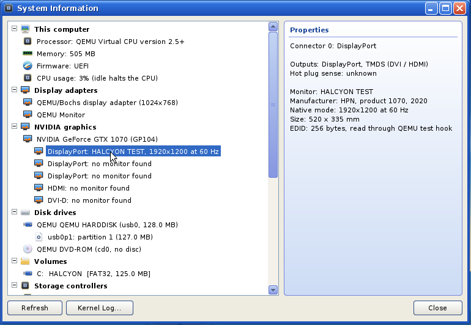

# Milestone 10 design: NVIDIA graphics

M10 brings a native driver for NVIDIA cards from the GeForce 256 to the
GeForce 10 series (see the roadmap). It is built in steps:

| Step | What | Status |
|------|------|--------|
| 10a | Identification: chip, VRAM, video BIOS and its tables, EDIDs over I2C / DP AUX, System Information, NVREPORT | **this document** |
| 10b | Modesetting on the NV50 "EVO" display engine (Tesla to Pascal) | written, host-tested; awaits the GTX 1070 |
| 10c | Modesetting on the VGA-style CRTCs (Celsius to Curie) | deferred |
| 10d | Hardware cursor, page flips at vertical blank, several monitors | written, host-tested; awaits the GTX 1070 |
| 10e | Acceleration with the copy engine (Kepler to Pascal, no firmware): uploads, copies and fills for the display core | written, host-tested; awaits the GTX 1070 |

The code lives in `kernel/drivers/nv/`:

| File | What | Host tested |
|------|------|-------------|
| `nvhw.h` | types and functions that touch no hardware | yes |
| `chip.c` | PMC_BOOT_0 / BOOT_42 to chipset, family, code name, register layouts; PCI IDs to card names; VRAM size from register callbacks | `tests/host/nvtest.c` |
| `vbios.c` | the PCI ROM image chain (IFR, PCIR, NPDE), BIT and BMP, DCB 1.5-4.1 with the I2C / CCB, connector and GPIO tables | `nvtest.c`, `fuzz_nv.c` |
| `i2c.c` | the bit-banged I2C master, one AUX transaction in the G94 / GM200 layouts, native AUX and I2C over AUX, EDID over DDC | `nvtest.c` (simulated buses) |
| `nv.h`, `nv.c` | the kernel side: probe, ROM sources, ports and pads, EDIDs, hot-plug sense; the API for 10b | QEMU test hook only |
| `report.c` | BOOT.LOG lines, the report text and register dump, System Information rows, `SYS_NV_QUERY` and the frame buffer speed test | QEMU (`nvfake`) |
| `evo.h`, `evo.c`, `evodp.c`, `evopll.c`, `evoscript.c`, `disp.c` | 10b: the EVO display engine and the modesetting driver (below) | `tests/host/evotest.c`; `disp.c` in QEMU (`nvfake`) |
| `evochan.c` | 10d: base and cursor channels, the vertical blank, output resources for several heads | `tests/host/evotest.c` |
| `fifo.h`, `fifo.c` | 10e: PFIFO (runlist, channel, RAMFC, USERD, GPFIFO), the GPU's page tables (GF100 / GM200 / GP100), the copy engine's methods, fences | `tests/host/fifotest.c` (simulated PFIFO, MMU, copy engine) |
| `accel.h`, `accel.c` | 10e: the kernel side: the guarded, deferred bring-up, the self test, the display core's accelerated operations | QEMU (`nvfake`: dry run only) |



## 10a: identification

### Rules

- **Read only.** The only writes are the ones reading needs, each undone at
  once: the PRAMIN window base (`0x001700`), the PROM shadow bit (PCI config
  `0x50` bit 0), the expansion ROM BAR's enable bit, the CRTC index and
  lock registers (pre-NV50 I2C), an I2C port's bit-bang register, a hybrid
  pad's mode, an AUX channel's request bits and auto-DPCD bit, and the AUX
  status register write-back nouveau also does. Every one is saved first and
  put back after the step; the BOOT.LOG says so if a read-back differs.
- **Nothing on screen changes**: no display engine register is written; an
  I2C pad whose DisplayPort sink answered is never switched to I2C.
- **No interrupts nobody answers.** An AUX transaction or a pad switch
  latches status bits in the I2C / AUX unit's interrupt status. Halcyon has
  no NVIDIA interrupt handler, so on G94 and later the monitors are only
  read if the function cannot interrupt (INTx disabled and no MSI), the
  GPU's interrupts are off (`PMC_INTR_EN`, `0x000140`, = 0, which is what
  the firmware usually leaves) or the AUX unit's enables (`0x00e068`,
  `0x00dc68` from Kepler on) are all off; otherwise the connectors say why
  and BOOT.LOG has `INTR_EN` and "I2C / AUX left alone". 10b, which owns
  the interrupt, uses `nv_i2c_xfer` / `nv_aux_xfer` freely.
- **Bounded.** Every wait has a limit measured with the TSC: 2.2 ms clock
  stretching and 200 ms per I2C transfer, 1 ms for an AUX channel to become
  idle and to be granted, 2 ms per AUX transaction, 32 DEFERs, 3 s per ROM
  source, 6 s and 6 timeouts for all of a card's EDIDs. A timeout or an
  unexpected value (all ones, an NV50+ "PRI error" `0xbadf....`, a big-endian
  card, memory decoding off, a BAR0 under 16 MiB) is logged and that step is
  given up.
- **Switches**: `nv.disable=1` in `SETTINGS.INI` or F8 Safe Mode
  (`BOOTF_NO_DISPLAY`) skip everything; `nv.i2c=0` skips I2C and AUX,
  `nv.prom=0` and `nv.rombar=0` those two ROM sources.
- `nv_init()` runs in `kmain` after `settings_load()` (for the keys) and
  before the first `bootlog_save()`, so the `nvN:` lines are in BOOT.LOG.
  It takes about 0.1-0.5 s per card (PROM reads and DDC dominate).

### Probe

Every PCI function with vendor `10de` and class 03 (VGA, 3D controller):
BAR0 must be memory, at least 16 MiB, and decoding (the firmware set the
card up); its 2 MiB pages are made uncached (`mm_set_uncached`, PAT entry 3)
when below 4 GiB, so the register mapping does not depend on the MTRRs.
`PMC_BOOT_1` (`0x000004`) bits `0x01000001` set means big-endian mode:
skipped.

**Chip.** `PMC_BOOT_0` (`0x000000`): bits 28:20 are the chipset when 28:24
are non-zero (NV10 and later), else `0x20004000` is NV04 and NV05;
`PMC_BOOT_42` (`0x000a00`, read on Fermi and later) wins only when it names
a chip of Turing or later that BOOT_0 cannot. The table in `chip.c` maps
every chipset to a code name and product line; the family follows from the
range:

| Chipsets | Family | Display engine | I2C / AUX | VRAM size from |
|----------|--------|----------------|-----------|----------------|
| 04, 05 | Fahrenheit (Riva TNT, out of range) | NV04 | CRTC | PFB_BOOT_0 |
| 10-1F | Celsius (GeForce 256, 2, 4 MX = NV17/18) | NV04 | CRTC | `0x10020c` (NV1A/1F: system memory) |
| 20-2A | Kelvin | NV04 | CRTC | `0x10020c` |
| 30-36 | Rankine | NV04 | CRTC | `0x10020c` |
| 40-4E, 63-68 | Curie (C51 = NV4E has its own I2C) | NV04 | CRTC / NV4E | `0x10020c` |
| 50-AF | Tesla (G80, G92, GT200: NV50 I2C; G94 on: AUX) | NV50 | NV50 / G94 | `0x10020c` with high bits; MCP7x `0x100e14` |
| C0-CF | Fermi GF100-GF116 | NV50 | G94 | FB partitions `0x11020c` |
| D7, D9 | Fermi GF117 / GF119 | GF119 | GF119 | FB partitions |
| E4-108 | Kepler | GF119 | GF119 | FBPAs (`0x022438`, `0x02243c`) |
| 117-118 | Maxwell GM10x | GF119 | GF119 | FBPAs, mask `0x021c14` |
| 120-126 | Maxwell GM20x | GF119 | GM200 | FBPAs per FBP (`0x022458`) |
| 130 | Pascal GP100 | GF119 | GM200 | `0x90020c` per FBPA |
| 132-138 | Pascal GP102-GP108 (GTX 1070: 134) | GF119 | GM200 | `0x100ce0` (MMU local memory range, ECC 15/16) |
| 140 | Volta | - | - | "not supported until Halcyon 1.1" |
| 160 on | Turing or later | - | - | "Turing or later: not supported until Halcyon 1.1" |

Volta and later are named only (no ROM, I2C or VRAM). The VRAM value must
be 1 MiB to 64 GiB in whole MiB, else "unknown". It is checked against BAR1:
up to Curie BAR1 maps all of it (a missing value is taken from BAR1, a
different one noted); from Tesla on BAR1 is a window and must not be larger.
The card's name comes from a table of about 130 PCI device IDs (checked
against the PCI ID database), else "<product line> (<code name>)".

**Bus.** The PCI Express capability's link status and capabilities (speed,
width; Kepler and later slow the link when idle, said in the report), or the
AGP capability's status and command registers.

### Video BIOS

Sources, in this order (as nouveau), every one read whatever the others gave,
the best kept:

| Source | How | Notes |
|--------|-----|-------|
| PRAMIN | NV50+: unless the display is fused off (`0x022500` Fermi, `0x021c04` Maxwell+ bit 0), `0x619f04` must say "enabled, in VRAM"; its address (bits 31:8 << 8, or `0x001700` << 16 + `0xf0000`) goes into the PRAMIN window `0x001700` (restored), the image is read at `0x700000`. Before NV50 the window shows it as it is. | The copy the VBIOS made at POST: what the GPU uses |
| PROM | PCI config `0x50` bit 0 cleared (restored) so the window at `0x300000` shows the flash, not the shadow. Skipped on integrated GPUs and if `0x50` lies inside a standard capability. | May start with IFR data (Maxwell, Pascal) |
| PCI ROM BAR | Only if the firmware assigned an address; sized, checked against the other BARs, enabled for the read only (BAR0 untouched meanwhile: the decoder may be shared) | |
| ACPI `_ROM` | Not available: it is an AML method and Halcyon has no AML interpreter | |
| Legacy shadow | `C0000`, first card only, only if the image's PCI device ID is this card's | BIOS boot |

Reads go 32 KiB at a time until the image chain is complete (at most 1 MiB,
3 s); a source with no ROM signature in its first 256 KiB stops early. Each
copy is kept (trimmed to its chain) for NVREPORT.

**Validation** (`nv_rom_scan`). The PCI ROM starts at 0 if `55AA` + PCIR are
there; else after an IFR header (`"NVGI"`: version 1 / 2, the offset at
`FIXED_DATA_SIZE + 4`; version 3, the ROM directory `"RFRD"` at the flash
status offset + 4096, the offset at +8); else at the first 512-byte boundary
with `55AA` and a PCIR structure (as the BIT specification says). Images
follow each other: signature (`AA55`, later ones also `BB77` / `"NV"`), PCIR
(also `NPDS`, `RGIS`), NPDE right after it (16-byte aligned) overriding size
and "last" (the legacy image says "last" for PC BIOSes). The legacy image's
bytes must sum to 0. Score: 1, +3 per image (+1 for a legacy image with a bad
checksum), +1 for a complete chain; 0 if PCIR's vendor is not NVIDIA. The
highest score wins, the earlier source on a tie.

**Pointers.** BIT / DCB pointers past the legacy image point into the
NVIDIA data image (code type `E0`; or the image after an EFI image): `p -
legacy_size + base_of_E0` (nouveau's rule; the BIT specification says the
same as "+ the EFI image's length"). All reads are bounds checked
(`nv_rom_rd8/16/32`) and count out-of-range reads.

**BIT** (`FF B8 "BIT"` in the legacy image): header size, token size and
count, checksum (a bad one is noted, parsing goes on); tokens as id,
version, size, pointer. The version comes from token `'i'` (or `'B'`):
`86.04.50.00.70` style. **BMP** (`FF 7F "NV" 00`, before NV40): version
5.x keeps a DCB pointer at `0x36`, older ones two CRTC I2C pairs at `0x48`
(BMP < 4) or in the BMP structure.

**DCB** (pointer at `0x36`): 4.x and 3.0 with the `4EDCBDCB` signature at
+6, header size / count / entry size, CCB at +4, GPIO at +10, connector table
at +20; 2.x with the signature at +4 and the I2C table at +2 (entries up to
it, GPIO through `dcb - 15` when `dcb[-1] >= 0x13`); 1.5 with `"DEV_REC"`
before it (10-byte entries, a different bit layout); older: nothing usable.
Entries stop at a type `E` or an all-zero / all-one word, type `F` is
skipped. Each output: type, CCB index, heads, connector, bus, location,
OR / pad macro, sub-link, external encoder, HDMI, DP lanes and rate, EDID
source. CCB 4.1 (GM20x+): I2C port and AUX channel per pad (`1F` = none, the
AUX channel is also the hybrid pad); CCB 3.0 / 4.0: access method 5 (I2C,
optional hybrid pad) or 6 (AUX); before 3.0: 16 fixed entries, CRTC
register pairs. Connector table 3.0 / 4.0: type, location, hot-plug lines A
to G, DP-to-DVI, AUX/I2C select. GPIO 3.x, 4.0, 4.1 (line, function,
logical states). DCB 2.x / 1.5 have no connector table: connectors are made
up from the outputs' connector fields (CRT + TMDS = DVI-I). Malformed parts
set bits in `problems` and are skipped; counts are capped (16 outputs,
CCB entries and connectors, 48 GPIOs, 40 BIT tokens).

### Monitors

A connector's outputs are tried DisplayPort first, then the I2C ones (DVI,
HDMI, VGA, a DP++ adapter), once per port:

| Port kind | Generations | Registers |
|-----------|-------------|-----------|
| CRTC-indexed | NV04-Curie | CR3F/CR3E (or the BMP / I2C table's pair) through `0x6013d4/5`, CR1F unlocked (0x57) and locked again |
| NV4E | C51 | `0x600800 + n` |
| NV50 | G80-GF116 | `0xe138, 0xe150, 0xe168, 0xe180, 0xe254, 0xe274, 0xe764, 0xe780, 0xe79c, 0xe7b8` (bits 0 SCL, 1 SDA) |
| GF119 | GF119-Pascal | `0xd014 + 0x20 n` (drive bits 0 / 1, sense bits 4 / 5) |
| hybrid pads | G94-GM10x / GM20x+ | `0xe500 / 0xe50c + 0x50 n`, `0xd970 / 0xd97c + 0x50 n`: I2C `0xc001`, AUX `0x0002` in bits `0xc003`, power bit 0 cleared |
| AUX | G94-GM10x / GM20x+ | `0xe4c0 / 0xd930 + 0x50 n`: data out +0, in +0x10, address +0x20, control +0x24, status +0x28; GM200: auto-DPCD +0x38 bit 16 |

I2C is bit-banged at 100 kHz with clock stretching, bus recovery (nine
clocks for a slave stuck mid-byte) and NAK detection. An AUX transaction
waits for the channel to be idle, requests it (control bits 22:20, granted
in 26:24), checks hot-plug sense (status bit 28), turns auto-DPCD off,
resets, starts (bit 16) and reads the reply (status 19:16, count 4:0, errors
bits 8-11), then puts the request and auto-DPCD bits back. On top: native
reads (DPCD) and I2C over AUX with MOT between messages, DEFER / I2C DEFER
retried 32 times 0.4 ms apart, NACK reported, and an address-only stop
after an error. The DPCD's revision and lanes are noted. EDID: block 0 at
`0x50` (header and checksum, three tries), then every extension (E-DDC
segment pointer `0x30` from block 2 on), up to 8 blocks. `edid.c` gained
`edid_timings()` (the detailed timings of the base block, CEA-861 blocks and
DisplayID type I / VII timings), `edid_block_count()` and `edid_ext_name()`.

Hot-plug sense: the connector's hot-plug lines map to GPIO functions
`07, 08, 51, 52, 5E, 5F, 60`, their line is read (`0x600818..` NV10,
`0xe104..` NV50, `0xd610 + 4 n` bit 14 GF119) and compared with the
"on" state.

### The interface for 10b (`nv.h`)

```c
typedef struct nv_device {
    pci_dev_t *pci; int index;
    volatile u8 *mmio; u64 mmio_phys, mmio_size; nv_regs_t regs;
    nv_chip_t chip;                 /* chipset, family, codename, disp / i2c / gpio / vram kinds */
    char name[96];                  /* "NVIDIA GeForce GTX 1070" */
    u64 vram, bar1_size; struct { int pcie, speed, width, max_speed, max_width; ... } link;
    nv_rom_copy_t rom[NV_SRC_COUNT]; int rom_best;   /* every copy read, and which is used */
    nv_bios_t *bios;                /* outputs (DCB), ccb (I2C), conn, gpio, tokens, version */
    int nconn; nv_connector_t conn[NV_CONN_MAX];     /* outputs on it, hot plug, EDID, edid_info_t */
    ...
} nv_device_t;

int  nv_count(void); nv_device_t *nv_get(int i); nv_device_t *nv_for_pci(const pci_dev_t *p);
u32  nv_rd32(nv_device_t *, u32 reg); void nv_wr32(...); u32 nv_mask(...); u8 nv_rd08(...); void nv_wr08(...);
int  nv_i2c_xfer(nv_device_t *, int ccb, nv_i2c_msg_t *msgs, int n);           /* pad + port taken and given back */
int  nv_aux_xfer(nv_device_t *, int ccb, u8 req, u32 addr, u8 *buf, u8 *len);  /* one AUX transaction */
int  nv_aux_read(nv_device_t *, int ccb, u32 addr, u8 *buf, int len);          /* DPCD */
int  nv_aux_i2c(nv_device_t *, int ccb, nv_i2c_msg_t *msgs, int n);            /* I2C over AUX */
int  nv_ccb_has_i2c(nv_device_t *, int ccb); int nv_ccb_has_aux(nv_device_t *, int ccb);
int  nv_read_edid(nv_device_t *, const nv_dcb_output_t *o, u8 *buf, int max, char *via, int vian);
const nv_dcb_output_t *nv_output(nv_device_t *, int index);
const nv_dcb_output_t *nv_output_on(nv_device_t *, int conn, int type, int nth);
nv_connector_t *nv_connector(nv_device_t *, int conn);
int  nv_hotplug(nv_device_t *, int conn);                                    /* 1, 0, -1 unknown */
```

The host-testable layer (`nvhw.h`) has the same pieces without a device:
`nv_chip_identify`, `nv_vram_probe`, `nv_rom_scan`, `nv_bios_parse` (+
`nv_rom_rd*` with the pointer rule, `nv_bios_token`), `nv_i2c_bb_xfer`,
`nv_aux_hw_xfer`, `nv_aux_native_read`, `nv_aux_i2c_xfer`,
`nv_ddc_read_edid`. 10b would add: the display engine's state read back
(the register dump below decodes the armed core channel state already),
the EVO core channel, and an adapter driver for the new display layer. The
DCB's output resource masks (`or_mask`), heads and links, and the CCB / AUX
mapping are what it needs to route a connector to a SOR and head.

### What the user sees

- **BOOT.LOG**: `nvN:` lines with the chip, BOOT_0 / BOOT_42 / PMC_ENABLE,
  BAR0 mapping, VRAM and how, the link; every ROM source's result and time;
  the VBIOS version and table versions; every DCB output (with its raw
  words); every connector with hot-plug state and monitor; the time taken
  and timeouts. Without a card: `nv: no NVIDIA graphics card`.
- **System Information**: an "NVIDIA graphics" book (only when there is a
  card): the card (name, chip, family, product line, VRAM, VBIOS version
  and source, bus, "Display driver:" the 10b driver's state, e.g.
  "native (GP102 display engine), in use on DP-1" or "firmware frame
  buffer; native driver failed: ...") and below it each connector: type,
  outputs, hot-plug sense, the monitor's name, maker, native mode, size and
  how its EDID was read.
- **NVREPORT.EXE** (`nvreport [/nospeed] [/quiet]`) writes
  `C:\HALCYON\NVREPORT\`: `REPORT.TXT` (the machine's display adapters and
  frame buffer; per card everything above, every image of every ROM copy,
  the BIT tokens, the DCB / CCB / connector / GPIO tables decoded with raw
  words, the monitors with all their timings, a read-only register dump: PMC,
  PFB and FB partitions, the display fuse, the shadow and PRAMIN windows, the
  display engine's armed state per head (timings, pixel clock, control),
  SOR / DAC / PIOR routing and power, raw core channel and PDISP words, the
  I2C / AUX / pad / GPIO registers; and the raw DCB; then the speed test),
  `VBIOS_<source>.ROM` per copy, `EDID<connector>.BIN`, and `README.TXT`
  (what the files are, that they describe the card and monitors only, that
  EDIDs carry the monitor's serial number). It asks before the speed test
  and says where the files are at the end (`/quiet`: no questions).
- **`SYS_NV_QUERY`** (196; the range 196-199 is reserved for graphics
  cards): `NVQ_COUNT`, `NVQ_REPORT` (a card, or -1 for the machine part),
  `NVQ_ROM` / `NVQ_ROMNAME` (copies by source), `NVQ_EDID` (by connector),
  `NVQ_FBTEST` (one test).

### Frame buffer speed test (for 10e)

Six tests of about 0.2 s each, one system call each so the desktop runs in
between and repaints itself after: fill with `rep stosq`, fill with 32-bit
stores, RAM to screen copy (what the compositor does), screen to screen copy
(half the screen up and down, reads the frame buffer), screen read, and RAM
to RAM copy for comparison. Reported as MB/s and whole frames per second at
the current mode, with the frame buffer's page attribute (write-combining
from M5). In QEMU (TCG) the numbers mean little; on the GTX 1070 they decide
whether 10e is needed: if RAM to screen stays far above 60 frames/s, CPU
drawing is enough.

### Tests

- `tests/host/nvtest.c` (`make -C tests/host nv`, part of `tests/host/run.sh`,
  ASan/UBSan): 96,000 checks. The chip table for every family and bad
  BOOT_0 values, BOOT_42; VRAM sizing for NV04, NV40, G92, GF110, GK104,
  GM204 and GP104 (with ECC) against simulated registers. A generator builds
  video BIOS images in 11 layouts (BMP 2.1 without DCB, BMP 5 with DCB 1.5
  and 2.2, BIT with DCB 2.2, 3.0, 4.0 and 4.1, a Pascal-style chain of PC-AT
  + EFI + NVIDIA data images with NPDE and tables behind translated
  pointers, the same behind IFR headers of versions 2 and 3, a ROM found at
  a 512-byte boundary), each checked field by field, cut at every length
  and mutated 20,000 times; then targeted damage: bad checksum (lower
  score), wrong vendor, image size 0, PCIR pointer outside, DCB signature
  and version, 255 x 255-byte entries, table pointers past the end, CCB 4.2,
  GPIO 5.0, connector 2.0, BIT checksum and absurd token counts, broken IFR
  offsets and directory. EDID: the timings of a base + CEA-861 + DisplayID
  EDID and 20,000 damaged extension blocks. I2C: the bit-banged master
  against a simulated open-drain bus with an E-DDC EEPROM (reads of 1-4
  blocks with segments, a buffer too small, no device, 1 ms clock stretching
  accepted, 5 ms refused, a slave stuck mid-byte freed, SDA stuck low for
  good, the total time limit, a register offset write). AUX: both register
  layouts and two channels against a simulated DisplayPort sink (DPCD, EDID
  over I2C over AUX in 1-4 blocks, DEFER and I2C DEFER, DEFER forever, no
  EDID device, no sink, never granted, never finishing, busy before, receive
  errors, sink timeouts retried, firmware request bits put back); every case
  checks that the request and auto-DPCD bits are as they were.
- `tests/host/fuzz_nv.c`: libFuzzer on `nv_bios_parse`, `edid_timings` and
  `edid_parse` (`make -C tests/host fuzz-nv-run`); the seeds (every generated
  layout) are replayed with gcc + ASan/UBSan in `run.sh`
  (`fuzz-nv-regress`). A 4-minute run: 5.6 million inputs, no crash.
- QEMU has no NVIDIA GPU and no way to give a PCI device NVIDIA's IDs (only
  `vfio-pci` takes `x-pci-vendor-id`), so the kernel side is tested through
  a test hook: `tools/boottest.py xhci:uefi:nvfake` (in the full matrix)
  passes `opt/halcyon/nvfake` (`0x134000a1,0x1b81`), `nvrom` (the generator's
  Pascal-style image) and `nvedid` through fw_cfg; the kernel makes a card
  without registers from them, logs it, and `NVREPORT.EXE /quiet` must write
  `REPORT.TXT` (with the speed test), `README.TXT`, `VBIOS_PROM.ROM` and
  `EDID0.BIN` byte for byte as passed in (mtools on the host). Every other
  boot of the matrix logs `nv: no NVIDIA graphics card` and changes nothing.

### Not verified without hardware

Everything that touches a real card: the BAR0 mapping, every register read
and the few writes above, the PRAMIN / PROM / ROM BAR reads, the I2C ports,
pads and AUX channels, hot-plug sense, VRAM sizing, and the timing of it all.
The register addresses come from nouveau, which runs on these cards; the
order of operations follows it, with save / restore added. The first test on
the GTX 1070 (NVREPORT and BOOT.LOG) is what 10b starts from.

### Status (paused here)

Done: everything above, committed, building without warnings;
`tools/ci.sh quick` passes, and the boot variants `xhci:bios`,
`xhci:uefi`, `nvfake` (BIOS and UEFI), `user`, `help` and `res+fwvideo`
pass. Without an NVIDIA card the code only logs `nv: no NVIDIA graphics
card` and adds nothing to System Information.

Remains for 10a:

- The first run on the GTX 1070: NVREPORT's folder and BOOT.LOG, then fix
  whatever the real card disagrees with (register values, ROM sources,
  I2C / AUX, VRAM, the interrupt guard's decision).
- Not implemented: ACPI `_ROM` (needs an AML interpreter), external
  encoders (DCB location 1), LVDS panels whose EDID comes from straps, the
  extended GPIO (XPIO) tables, merging DCB 2.0's duplicate entries, the
  head owner (CR44) on dual-head pre-NV50 cards, a dedicated F8 entry
  (Safe Mode and `nv.disable=1` cover it), ROM / I2C for Volta and later.
- Expected merge points with the new display layer: `SYS_COUNT` (now 200,
  196-199 reserved), `CAT_NVIDIA` in `sysinfo.c`, the `nv_init()` call in
  `kmain.c`, the functions appended to `edid.c` / `edid.h`.

## 10b: Tesla to Pascal modesetting

10b drives the NV50 "EVO" display engine of Tesla (G80-GT21x, MCP7x),
Fermi, Kepler, Maxwell and Pascal (GP10x) cards as a native adapter of the
display core: any mode the monitor's EDID offers, resolution changes
without a restart, the firmware frame buffer as the fallback. It is a port
of nouveau's display code (MIT; `nvkm/engine/disp`, `nvkm/subdev/bios`,
`nvkm/subdev/devinit`, `nvkm/subdev/clk`, `dispnv50`); no firmware is
loaded. Single-buffered scanout from VRAM with the software cursor; the
hardware cursor, page flips and several monitors at once are 10d (every
head and connector is registered already, and a second monitor uses the
same code, but nothing was done for it).

### Files

| File | What | Host tested |
|------|------|-------------|
| `evo.h` | the interface of the parts below (no kernel dependencies) | |
| `evo.c` | generations, method streams per class, rasters, the object table and context DMAs, the VRAM allocator, the core channel, the takeover, the supervisor, release | `tests/host/evotest.c` |
| `evodp.c` | DisplayPort: link configurations, bandwidth, transfer unit and watermark, DPCD over AUX, link training | `evotest.c` (simulated sink) |
| `evopll.c` | the video PLLs: the VBIOS PLL limits table (3.0, 4.0, 5.0), nouveau's GT215 and NV04 calculators, the register sequences | `evotest.c` |
| `evoscript.c` | the VBIOS display tables (IED output scripts, BIT `U`; DisplayPort, BIT `d`) and the init script interpreter | `evotest.c` |
| `disp.c` | the kernel side: registration, BAR1 and VRAM, the start guard, takeover, detect / mode_valid / buffers / set_mode, restore, the hot-plug poll | QEMU (`nvfake`) |

### How a mode gets on the screen

**Registration** (`nv_display_probe`, at the end of `nv_init`, read only):
for each identified card whose chipset has an EVO engine
(`nv_evo_gen_for`), with a video BIOS and a DCB, unless `nv.modeset=0`, F8
Safe Mode / safe video or `nv.disable=1`: one adapter `nv` with the card's
name, `live`, `guarded`; a head per bit of the head mask (`0x612004` and
`0x022448` on GF119+, two before); one connector per DCB connector with a
TMDS, DisplayPort or analog output on the chip (`DP-1`, `HDMI-1`,
`DVI-D-1`, `DVI-I-1`, `VGA-1`; TV outputs, LVDS / eDP panels and external
encoders are not driven), its heads from the outputs' head masks. The
display core learns from BAR1 whether the card shows the firmware frame
buffer.

**enable** (from `display_start`, on the GUI thread):

1. No hardware for the simulated card, no registers, a fused-off display
   engine (`0x022500` / `0x021C04` bit 0), no BAR1 of at least 64 MiB: fail
   with the reason.
2. BAR1 is mapped (uncached); the window is `min(BAR1, VRAM, 4 GiB)`. The
   firmware frame buffer (`g_bootinfo`) must lie inside it at 32 bpp for
   restore to work.
3. VRAM we must not use: the first 2 MiB, the firmware frame buffer (2 MiB
   pages), the VBIOS shadow (`0x619f04`), the firmware's display objects
   (`0x610010`), the BAR1 / BAR2 page tables (`0x001704` / `0x001714` when
   bit 31 is set) and the last 16 MiB of VRAM. A 2 MiB block holds our
   objects: the instance memory (64 KiB: the object table at its start, two
   context DMAs after it), the push buffer (4 KiB, in VRAM as nouveau does
   on Pascal) and the notifier (4 KiB). Buffers get their own 2 MiB pages
   (the display core sets write-combining per page).
4. **BAR1 must map VRAM 1:1**: a pattern written through BAR1 at two places
   in our block must read back through the PRAMIN window (`0x001700`,
   `0x700000`, VRAM directly) at the same offset, and the firmware frame
   buffer must read the same both ways. Every new buffer is checked the
   same way at both ends. Otherwise: "BAR1 does not map VRAM linearly".
5. The **start guard** (`display_guard_begin`): the marker goes to
   SETTINGS.INI and BOOT.LOG is saved.
6. INTx off in the PCI command register, then `nv_evo_takeover`:
   - the engine's resources and **the firmware's state**: the armed state of
     every head (raster, pixel clock, depth, core surface) and output
     resource (owner, protocol, link), which DCB output each armed OR drives
     (`map_armed`, GM200+ through the SOR routing `0x612308`), the lit head
     (`nv_evo_find_fw`); all of it logged;
   - our object table and context DMAs written through BAR1 (GF119 / NV50
     formats), the BAR flushed (`0x070000`, NV50 `0x00330c`);
   - the GPU's interrupts masked (`0x000140` = 0; GP100+ `0x000180` all
     ones);
   - `nv50_disp_init` / `gf119_disp_init`: the capability copies, the
     display taken from the VBIOS (`0x6100ac` / `0x610024` bit 8,
     `0x6194e8`), `0x610010` = our instance, supervisor interrupts on (their
     status is what is polled), everything else off, underflow reporting off
     (GF119+);
   - every OR's "normal" power state on (`0x61c004`, `0x61a004`; 200 ms per
     wait, not 2 s);
   - the firmware's core channel stopped if it runs, ours started (push
     buffer `0x610204` / `0x610494` / `0x611494` on GP102), the notifier's
     context DMA set and the channel seen to fetch it (GET = PUT).
   Every register written here is saved first (`nv_evo_saved_t`).

**detect**: the hot-plug line (GPIO), a DisplayPort sink's capabilities
(DPCD `0x000`, the extended field at `0x2200`, capped by the DCB's lanes and
rate), the EDID over AUX or DDC (10a's code; AUX is safe now that the GPU
cannot interrupt), else the copy 10a read at boot. The output used on a
connector: DisplayPort if a sink answered, else TMDS (unless the EDID says
analog), else the DAC. HDMI sinks are recognised from the CEA-861 vendor
block.

**mode_valid**: no interlace; at least 25 MHz; TMDS 165 MHz single link,
330 MHz dual link (DCB 4.x link 3, not for HDMI sinks), HDMI sinks
225 MHz on Fermi, 297 MHz on Kepler / GM107, 340 MHz from GM200 (no
scrambling); DisplayPort: the mode at 24 bits per pixel must fit lanes x
rate after 8b/10b; DACs 400 MHz; the generation's raster limit.

Refresh rates (after 10d): the driver sets `a->rates`, so the display core
offers every refresh rate the EDID lists (base block, CEA-861 and
DisplayID detailed timings, standard and established timings) and calls
`mode_valid` for each timing on its own; Display Properties has a Refresh
rate drop-down (DESIGN-M10-DISPLAY.md, "Refresh rates"). The head's limit
is the generation's (1080 MHz on Pascal, `nv_evo_head_max_khz`); for
DisplayPort the check uses the most the link can carry — `lanes_max` and
`bw_max` from detect (the DPCD's, capped by the DCB entry and
`dp_max_bw`), not the configuration a previous mode set trained, since
`set_mode` retrains for each mode's clock with the widest and fastest
configuration first (`nv_dp_configs`: 4 x 8.1, 4 x 5.4, ... GHz). The
clock is the EDID's exactly (679.30 MHz for the LG UltraGear's 165 Hz);
the GF100-style fractional PLL hits it exactly. The user's monitor: 60,
120 (preferred), 144 and 165 Hz at 2560 x 1440; 165 Hz needs 2037.9 MB/s,
which 4 lanes at 5.4 or 8.1 GHz carry and 2 lanes do not. evotest checks
the GP104's PLL with tables reconstructed from NVREPORT's coefficients for
497.75 MHz and the four mode sets on the simulated GP104 (see the
HARDWARE.md steps for 144 and 165 Hz).

**set_mode**: the output resource is the DCB output's own OR before GM200;
from GM200 the SOR already routed to it, else a free one, else one only the
firmware used (`nvkm_outp_acquire`). One update carries, in nouveau's
order: at the first mode set the firmware's head off and its OR detached
(unless we take them over), the head's previous OR detached, then for the
head the LUT and cursor off, the viewport, the raster and pixel clock, the
core layer (pitch-linear A8R8G8B8 at the buffer's VRAM offset through the
VRAM context DMA), base / overlay bounds, dither and procamp off, the
output resource word (GF119+), the OR control word (owner, protocol, and
before GF119 polarities and depth), then `SET_NOTIFIER_CONTROL` + `UPDATE`.
TMDS uses link A or B, dual link at 165 MHz and above when possible; DP
uses 24 bpp. A DisplayPort output's hybrid pad is held in AUX mode.

**The update** (`nv_evo_submit`): the words go into the push buffer (a
`JUMP` to 0 when it would run into the last 12 words), the BAR is flushed,
PUT written. Then, polled, for at most 3 s: the supervisor status
(`0x6100ac` / `0x610024`), answered as nouveau's `nv50_disp_super` /
`gf119_disp_super` do:

| Round | For each head whose state changes |
|-------|-----------------------------------|
| 1 | read the armed and assembly state; the old OR's IED script OffInt1 |
| 2 | OffInt2, DisplayPort DisableLT when the OR loses its only head; GM200+ routing; the video PLL of heads whose clock changes; then for the new OR: DisplayPort link training, the IED script OnInt2 for the clock, the RG divider, DisplayPort transfer unit and watermark, the SOR / DAC clock, the G94 TMDS workaround |
| 3 | OnInt3, the G94 workaround's second half |

then the release word (`0x6101d0` / `0x610030`). The channel's error
registers are checked all along (method, data, reason logged, cleared);
the update is done when the notifier's DONE bit is set. Afterwards the
armed state is read again: which OR drives which output now.

**DisplayPort link training** (`nvkm_dp_train`): the sink woken (`0x600`),
enhanced framing from the sink, the VBIOS scripts EnableSpread /
DisableSpread and BeforeLinkTraining, then configurations from most lanes
and the highest rate down while the data rate fits: the link-rate script,
the SOR's lanes and rate, lane power, the sink's `LINK_BW_SET`, clock
recovery (pattern 1, drive levels from the VBIOS DP table for the sink's
adjust requests, at most 5 tries per swing level) and equalisation
(pattern 2, 3 with TPS3 from GF119, 4 with TPS4 from GM107; 5 tries), then
pattern 0, AfterLinkTraining. A failure makes the mode set fail.

**Video PLLs** (`nv_evo_vpll_set`): the limits of `VPLL<head>` from the
PLL table; NV50-G98 the two-stage calculator and `0x10000611` + N1/M1 +
P/N2/M2, GT215 / MCP89 `0x50000610` + P/M/N + fractional N, GF100 to
Pascal P/N/M at `reg + 4` and fN at `reg + 0x10`. A register that is not a
PLL register is never written. A table 5.0 names no register (nouveau would
write at 0): the PLL is left to the display engine and the log says so.

**restore** (the display core's fallback): when our channel runs and the
firmware frame buffer is in BAR1, one update switches our heads off and
programs the firmware's head again from the state read at takeover (its
raster, clock, polarities, depth, OR and protocol, the viewport from the
frame buffer's size to the raster's), scanning out the firmware frame
buffer (its own pitch word when the pitch is not a multiple of 256), with
DisplayPort retrained. Then every saved register is put back, except the
channel, the instance pointer and the VBIOS ownership while our channel
runs, and the GPU's interrupt enables, which stay masked. If the channel
never came up, only the registers are put back: the hardware still shows
the firmware's armed state, as no update was made.

### Generations

| Chipsets | nouveau display | Core class / methods | Registers | SOR state | DisplayPort | Video PLL | Notes |
|----------|-----------------|----------------------|-----------|-----------|-------------|-----------|-------|
| 50 (G80) | nv50 | 507d / 507d | NV50 | `0x610b70` | - | NV50 two-stage, fixed map `0x614100` | BAR flush `0x00330c` |
| 84, 86, 92 | g84 | 827d / 827d | NV50 | `0x610b70` | - | NV50 | |
| 94, 96, 98 | g94 | 887d / 827d | NV50 | `0x610794` | G94 (lanes 2,1,0,3), 2.7 GHz | NV50 | TMDS workaround |
| A0 (GT200) | gt200 | 837d / 827d | NV50 | `0x610b70` | - | NV50 | |
| A3, A5, A8 | gt215 | 857d / 827d | NV50 | `0x610794` | G94 | GT215 | |
| AA, AC | mcp77 | 887d / 827d | NV50 | `0x610794` | G94 | NV50 | |
| AF | mcp89 | 857d / 827d | NV50 | `0x610794` | lanes 3,2,1,0 | GT215 | |
| C0-CF (GF100-GF116) | gt215 | 857d / 827d | NV50 | `0x610794` | G94 | GF100 | |
| D7, D9 (GF119) | gf119 | 907d / 907d | GF119 | `0x640200` | GF119 (TPS3), 5.4 GHz | GF100 | dither at `0x490` |
| E4-E7 | gk104 | 917d / 917d | GF119 | `0x640200` | GF119 | GF100 | |
| F0, F1, 106, 108 | gk110 | 927d / 917d | GF119 | `0x640200` | GF119 | GF100 | |
| 117, 118 | gm107 | 947d / 917d | GF119 | `0x640200` | GM107 (TPS4, lanes 0-3) | GF100 | |
| 120, 124, 126 | gm200 | 957d / 917d | GF119 | `0x640200` | GM200 drive | GF100 | SOR routing |
| 130 (GP100) | gp100 | 977d / 917d | GF119 | `0x640200` | GM200 | GF100 | no DACs |
| 132-138 (GP102-GP108; GTX 1070: 134) | gp102 | 987d / 917d | GF119, push buffer at `0x611494`, errors at `0x6111f0` | `0x640200` | GM200, 8.1 GHz | GF100 | no DACs |

Volta and later: identification only, as in 10a.

### Interrupts

Halcyon has no NVIDIA interrupt handler and the kernel's model is
"interrupts only wake, drivers work polled". So while the driver owns the
display: INTx is off in the PCI command register and the GPU's interrupt
enables are masked at the top (`PMC_INTR_EN`, `0x000140`; on GP100+ the
leaf enables through `0x000180`), and stay so after a fallback (nobody
would answer them). Inside the display engine the supervisor's interrupt
enables are set as nouveau sets them, so that its status register latches
the supervisor requests the update loop polls; everything else (channel
completion, vertical blank, errors) is off and polled from status
registers. AUX transactions and I2C are therefore always allowed in 10b.
10d keeps this: no interrupt path (see "10d: interrupts").

### Safety

- **Nothing is written before display_start**; registration reads only.
  Before the start marker, the only writes are those of 10a's kind (the
  PRAMIN window, put back) and the BAR1 test pattern in our own VRAM block.
- **Bounded everywhere**: two updates in a row that time out give the
  channel up (later updates, a restore included, fail at once); channel
  start / stop 2 s, an update with its
  supervisor rounds 3 s (at most 12 rounds), GET catching up 2 s, BAR flush
  2 ms, OR power 200 ms per wait (1 ms after the first that ran out), AUX 32
  DEFERs per transfer, link training 8 configurations and 40 tries, VBIOS
  scripts 4096 opcodes / 8 levels / 1 s of delays. A register reading all
  ones or a PRI error ends the step.
- **Registers**: everything the takeover writes is saved and put back by
  release; VBIOS scripts may only write `0x00d000-0x00efff` (GPIO, I2C,
  pads, NV50 PLLs), `0x0c0000-0x0c0fff` and `0x601000-0x603fff` (VGA) and
  `0x610000-0x61ffff` (the display engine): other writes are refused and
  logged, POST opcodes (memory, clocks, resets, the NV50 `IO 3c3` PLL
  sequence) stop the script, PLL and GPIO opcodes are skipped and logged; a
  video PLL is written only at a PLL register.
- **The fallback rule** at every step: any error returns an `E_*` with the
  reason in the adapter's `why`; the display core goes back to the previous
  configuration or gives the device back (restore) and uses the firmware
  frame buffer, with the reason in BOOT.LOG, System Information and
  NVREPORT.
- **The start guard** (in the display core, for every driver with
  `guarded`): `display.nv.guard=start` is saved (with BOOT.LOG) right
  before the first register write. When the desktop is up, a configuration
  (connectors and modes) confirmed before clears the marker after 10 s;
  a new one asks "Halcyon now uses its own driver for the NVIDIA GeForce
  GTX 1070. Can you see this message?" (Yes / No, No is the default for
  Enter, 15 s), Yes saves it as `display.nv.confirmed` and clears the
  marker, anything else gives the device back. A marker found at the next
  start ("the start did not finish": a hang, a crash, a black screen the
  user switched off) becomes `blocked`: the driver is not started, BOOT.LOG,
  System Information (adapter "disabled") and a balloon say so, until
  Display Properties' **Turn on driver...** (Settings tab) or removing the
  key. A driver that failed after touching the device keeps its marker too.
  BOOT.LOG is also saved before the first mode set.
- **Switches**: `nv.disable=1` and F8 Safe Mode (nothing of M10),
  `nv.modeset=0` (identification only, the firmware frame buffer),
  `display.disable=nv` (the display core leaves the driver off),
  `nv.scripts=0` (no VBIOS display scripts: for diagnosis),
  `display.nv.guard` as above.
- **Logging**: every step goes to BOOT.LOG with the `nv0:` prefix (the
  firmware state, the VRAM layout and BAR1 check, each register block, each
  supervisor round and script with its counts, PLL coefficients, DP
  training, errors) and to a copy NVREPORT adds to REPORT.TXT ("Native
  modesetting (M10b): the driver's log of this start").

### Tests

- `tests/host/evotest.c` (`make -C tests/host evo`, in `run.sh`,
  ASan/UBSan): 41,762 checks. Generations for every chipset; the method
  streams of one head for 507d, 827d (with a DAC), 907d and 917d compared
  word by word with sequences written out from nouveau's `head*.c`,
  `sor*.c`, `dac*.c`, `core507d.c`; head and OR off; rasters (CEA 1080p,
  CVT-RB 1440p, bad timings); the object table hash and the GF119 / NV50
  context DMAs, a full table; the VRAM allocator with random holes; PLL
  tables 3.0, 4.0 and 5.0, the GT215 calculator against values worked out by
  hand (148.5 MHz: N 115, fN 0, M 1, P 21) and within 0.01 % from 25 to
  600 MHz, the two-stage calculator within its VCO limits and 0.5 %; DP
  configurations, bandwidth, the transfer unit and watermark against
  hand-computed values (1080p60 on 4 x 2.7 GHz: 490 / 1905 symbols,
  watermark 21) and 2,000 random ones; a test VBIOS with IED and DP tables
  and scripts: conditions, NOT, RESUME, SUB, REPEAT, macros, the OR / link /
  head selectors, refused writes, an unknown opcode, an endless JUMP, reads
  past the end, 3,000 random scripts (they never write outside the
  allowed registers). A **simulated display engine** (both register
  layouts) executes the push buffer, resolves handles through our object
  table, runs three supervisor rounds per update, arms the state and writes
  the notifier; with a simulated DisplayPort sink. On it, for GP102, GP100,
  GM200, GM107, GK104, GF119, GF104, GT215, G94, G84 and G80: the takeover
  (the firmware's head and output found, the VBIOS ownership, the
  instance pointer, the interrupt masks, the channel running), a 1080p mode
  set (three supervisor rounds, the IED scripts with the right OR / head,
  the refused write not done, the video PLL coefficients, DP training and
  transfer unit, GM200 routing moved to another SOR), the firmware's mode
  armed again by restore, the saved registers back. And the hangs: a
  channel that never starts, never fetches, an update without notifier,
  without supervisor, a channel error (both layouts), a VBIOS that keeps
  the display, a dead card, a stuck BAR flush, a layout outside VRAM, a
  stream too long, 40 updates wrapping the push buffer; DP: a sink that
  needs more swing (the drive levels from the VBIOS table), one that never
  locks, none, one too small, the DCB capping the rate.
- QEMU: `nvfake` (UEFI) registers the simulated GTX 1070 (GP102 engine, 4
  heads, 5 connectors) and must log that it is not touched, after a dry run
  of the first mode set from its EDID (the method stream is built and
  logged, 56 words for 1920x1200 on DP-1, nothing is sent); NVREPORT says
  "Display driver: firmware frame buffer..." and adds the driver's log;
  `nvfake+nvoff` (BIOS) checks `nv.modeset=0`. The start guard is tested
  on the virtio GPU through a test hook (`opt/halcyon/displayguard`):
  `guard` (nobody confirms: back to the firmware frame buffer after 15 s,
  the marker stays) and `guardblock` (a marker from the last boot: not
  started, the marker becomes `blocked`).

### Verified only on the host

Everything that touches a real card: the register addresses and
sequences (from nouveau, which runs on these cards; our simulator models
nouveau's view of them, not the silicon), the BAR1 / PRAMIN behaviour, the
VBIOS tables of real boards (the parsers were tested on generated tables
in nouveau's layouts), whether the GOP's state is as `nv_evo_find_fw`
expects, link training against real sinks, the PLL limits of real tables
(a version 5.0 table on Pascal would leave the pixel clock to the display
engine), the timing of everything, and the restore path on hardware.

### First run on the GTX 1070 (Halcyon 1.0.199)

GP104, VBIOS 86.04.1e.00.01, UEFI, an LG UltraGear on DisplayPort
(connector 1, SOR2, AUX channel 3). The driver took the display from the
VBIOS, trained the link at 4 lanes x 8.1 Gbit/s with enhanced framing,
programmed VPLL0 for 497.75 MHz and ran the monitor's preferred
2560x1440 at 120 Hz on head 0, with 0 refused script writes. The PLL
table was version 4.0, so the pixel-clock risk above did not apply.

One bug: the picture was grayscale. The head's `HEAD_SET_PROCAMP` was
written as 0, and its SAT_COS field (bits 19:8) is the saturation, so 0
removed all colour. Unity is 1024 (nouveau's default colour vibrance
gives the same value; the firmware leaves its unused heads at
`00040000`). Fixed for both method layouts (0x0498 on 907d and later,
0x08A8 on 507d / 827d), and evotest's expected streams now carry it.

Also seen: "firmware frame buffer not in BAR1", so a fallback could only
switch the heads off. The log line now prints the loader's frame-buffer
address and depth to find out why. The CPU drawing speed test gave 205
frames/s for RAM-to-screen copies at 2560x1440, so 10e (2D acceleration)
is not needed for the desktop's speed; 10e (below) takes the copies off the
CPU instead.

### What to check on the GTX 1070

1. Boot from the stick (UEFI). The screen flickers once when the driver
   takes over. Expect "Halcyon now uses its own driver ... Can you see this
   message?": click **Yes**. If the screen is dark, wait 15 s: the
   firmware's picture should come back by itself.
2. Display Properties: the monitor's own resolutions (e.g. 2560 x 1440)
   are offered; try one ("Do you want to keep these settings?").
3. If the screen stays dark or the machine stops: switch off; at the next
   start Halcyon leaves the driver off and says so. Then send
   `\HALCYON\BOOT.LOG` and `BOOTPREV.LOG` (the start that went wrong) and
   NVREPORT's folder (run `NVREPORT` again: REPORT.TXT has the driver's log
   and the register dump after the fallback).
4. Try each connector (DisplayPort, HDMI, DVI) if you can; `nv.scripts=0`
   in SETTINGS.INI is worth one try if a connector stays dark ("Turn on
   driver..." in Display Properties first).
5. If anything goes badly wrong: `nv.modeset=0` keeps the firmware's
   picture, `nv.disable=1` leaves the card alone.

What to send back: BOOT.LOG, BOOTPREV.LOG, the NVREPORT folder, which
connector and monitor (with its resolution), and what the screen did.

### Not done (10b)

- Hardware cursor, page flips, vertical blank, several monitors at once:
  10d (below).
- HDMI mode (infoframes, audio, scrambling above 340 MHz): HDMI sinks get
  a DVI-mode signal. LVDS / eDP panels, TV outputs, external encoders
  (PIOR), MST, LTTPRs, eDP link rate tables, DisplayPort retraining after
  a sink's IRQ, HPD interrupts (polled once a second from the GPIO lines).
- The VBIOS PLL / GPIO script opcodes are skipped (the driver programs the
  video PLLs itself); scripts on pre-NV50 boards (10c).
- Restore cannot bring back an interlaced or 24 bpp firmware mode; after a
  failed takeover the display engine stays with the VBIOS's ownership bit
  cleared (nouveau never gives it back either).
- Not verified on any real card yet (above).

## 10d: cursor, page flips, several monitors

10d gives every head of the EVO driver what the display core already
offers on the virtio GPU: a **hardware cursor**, **tear-free page flips**
completing at the vertical blank, **vertical blank waits**, and **several
monitors at once**, each on its own head with its own output resource,
video PLL and DisplayPort link. It is ported from nouveau (MIT): the base
and cursor channels of `dispnv50` (`base507c.c`, `base827c.c`,
`base907c.c`, `curs507a.c`, `wndw.c`), the cursor and base usage bounds in
the core channel (`head507d.c` ... `head917d.c`), the channel bring-up of
`nvkm/engine/disp` (`nv50.c`, `gf119.c`, `gp102.c`, `chan.c`), the
scanline position (`nv50_head_rgpos`) and the output resource choice
(`outp.c`). The hardware logic is in `evochan.c` (host-tested like the rest
of the EVO code); `disp.c` uses it. Every feature degrades to the 10b
behaviour on its own: single-buffered scanout from the core channel, the
software cursor, one head.

### Channels

Besides the core channel, each head has two channels of its own:

| Channel | Classes (by generation) | Ids: control / user | What it does |
|---------|-------------------------|---------------------|--------------|
| base (DMA, push buffer) | 507c (G80), 827c (G84), 837c (G94, GT200, MCP77), 857c (GT215, MCP89, GF100-GF116), 907c (GF119), 917c (GK104), 927c (GK110 to GP108) | 1 + head / 1 + head | the head's primary surface: page flips |
| cursor (PIO, immediate) | 507a (G80), 827a (G84-MCP77), 857a (GT215-GF116), 907a (GF119), 917a (GK104 to GP108) | NV50 family 7 + head / 7 + head; GF119 to GP100 13 + head / 13 + head; GP102+ 13 + head / **17** + head | the cursor's position |

The control register is `0x610200` (NV50 family) or `0x610490` (GF119+) +
ctrl x 0x10; the push buffer registers `0x610204` / `0x610494` /
`0x611494` (GP102) + ctrl x 0x10; PUT / GET or the PIO window at
`0x640000 + user x 0x1000`. A channel's errors are bit `user` of `0x61009c`
(registers at `0x6101f0` / `0x6111f0` + user x 12) or bit `16 + user` of
`0x610020` (`0x610080` + user x 8), polled; its error reporting is enabled
as nouveau does (`0x6100a0` / `0x610028`), saved and put back by release.

**Bring-up** (`nv_evo_base_start`, `nv_evo_curs_start`), after the takeover,
for every registered head:

- base: two context DMAs bound to the channel in the object table (the
  notifier page and all of VRAM; objects at `0x1040 + head x 0x40`, the
  channel's id in the hash and the context word), a firmware channel that
  runs is stopped first, error reporting on, the push buffer (4 KiB in VRAM)
  at `ctrl` + 4 / 8 / 12, PUT 0, control `0x13`, wait for bit 31 to clear,
  then the LUT methods (base and output LUT off, the LUT context DMA 0, the
  colour space conversion owned by the core: `base*_xlut_clr`,
  `base907c_csc_clr`) and GET = PUT;
- cursor: a firmware channel stopped, error reporting on, on the NV50
  family `0x2000` (out of reset) and bits 17:16 clear, then `0x1` and
  bits 17:16 = 1.

Every wait is 200 ms (nouveau: 2 s). One base channel that does not start
turns page flips off on every head; one cursor channel the hardware cursor
(a mixed desktop gains nothing); BOOT.LOG says which and why. The VRAM for
them is in the 2 MiB block of 10b: base push buffers at +72 KiB (4 KiB per
head), cursor images at +128 KiB (two 16 KiB images per head).

### Page flips

In a mode set the head's **base usage bounds** say the base channel may
show 32 bpp surfaces (`0x301`; 917d also BASE_LUT USAGE_1025: `0x20301`);
the core layer shows the mode's first buffer as in 10b, and the base layer
starts off. `flip` queues on the head's base channel (base*_ntfy_set,
base*_image_set, base507c_update, not interlocked with the core):

```
SET_NOTIFIER_CONTROL      offset of the slot in the notifier page   (0x00A0, with CONTEXT_DMA_NOTIFIER)
SET_PRESENT_CONTROL       0x10: BEGIN_MODE NON_TEARING, MIN_PRESENT_INTERVAL 1
SET_CONTEXT_DMA_ISO       the VRAM context DMA
(507c / 827c)             SET_PROCESSING, SET_CONVERSION = 0
SURFACE_SET_OFFSET        VRAM offset >> 8         (507c: 0x0800 x1 + 0x0808 x3; 827c: 0x0800 x5; 907c+: 0x0400 x5)
SURFACE_SET_SIZE          height << 16 | width
SURFACE_SET_STORAGE       PITCH layout, pitch / 256 (bit 20 or 24)
SURFACE_SET_PARAMS        0xCF00 (A8R8G8B8)
UPDATE                    0
```

The notifier slots are nouveau's (`0x40` per channel after the core's,
`+0x20` and `+0x30` used in turn, reset to NOT_BEGUN before each image).
**Completion** is polled from `poll`: the slot's status (bits 31:30) BEGUN
or FINISHED and the channel's GET equal to its PUT; then
`display_flip_done`. There is no interrupt: `flip` asks the idle loop to
wake at the expected vertical blank (from the scanline position) + 1 ms,
and `poll` asks again every millisecond while a flip is pending.

**When flips end on a head** (a channel error, a flip that does not
complete within four frames, at least 100 ms and at most 200 ms, before
the display core's 250 ms, or a flip that cannot be queued): the base layer
is switched off (bounded, 50 ms) and its channel stopped, the core layer is
pointed at the buffer the display core takes as the front one (with the
cursor re-specified: EVO refuses a new ISO surface with an active cursor
otherwise), and `HEAD_CAP_FLIP` is cleared: the display core then
single-buffers on that buffer (the display core gained that: a head whose
flips were given up used to keep flipping). Before every mode set and head
off the base layer is switched off (100 ms); if it does not go off, flips
end on that head and the mode set goes on.

### The hardware cursor

64 x 64 A8R8G8B8 on every EVO generation (no 32 x 32-only chip is in
range). Two images per head in VRAM: a new shape goes into the slot not on
screen and the core channel is pointed at it (no tearing); an unchanged
shape is not uploaded again. Shown and hidden through the core channel
(`HEAD_SET_CONTROL_CURSOR` = `0x85000000` / `0x05000000`,
`HEAD_SET_OFFSET_CURSOR`, and `HEAD_SET_CONTEXT_DMA_CURSOR` on 827d and
later; 507d fetches it through the head's ISO context DMA), one core update
each (no supervisor, about one frame). The position goes through the cursor
channel: `FREE` (bits 5:0) at least 4 within 1 ms, then
`SET_CURSOR_HOT_SPOT_POINT_OUT` (`0x84`: the image's top left, signed 16-bit
x and y, so a hot spot near the left or top edge gives negative values the
hardware clips) and `UPDATE` (`0x80`). The display core's position is the
hot spot's; the driver subtracts the hot spot (as the virtio driver's
device does). A move the channel has no room for is dropped and counted;
100 in a row, an image that does not reach VRAM or a core update that fails
turn the hardware cursor off on every head (the display core draws the
software cursor). The display core shows the cursor on the head under the
hot spot and hides it on the others.

### The vertical blank

`wait_vblank` reads the head's scanline position (`0x616340 + head x
0x800`, as nouveau's `nv50_head_rgpos` on every EVO generation) against the
armed raster (in the blank: line >= blank start or <= blank end): out of the
blank if it is in it, then into the next one; bounded by the caller's limit
(50 ms) and two frames; a counter that stays on one line for four lines'
time plus 1 ms ends the wait (`E_TIMEOUT`, logged), a register reading all
ones or a PRI error at once. Three failures in a row clear
`HEAD_CAP_VBLANK`. The display core does not call it today; it is there for
the interface and for the flip wake-up estimate (`nv_evo_us_to_vblank`).

### Interrupts: none (the decision)

10d adds **no interrupt path** and no `nv.irq` setting. Reasons: Halcyon's
interrupts only wake, and polling must be correct anyway; the flip
completion is polled with a wake-up scheduled at the expected vertical blank
from the scanline counter, so its latency is the same as an interrupt's
(within about 1 ms); an interrupt handler for a GPU that can only be tested
on the user's card risks an interrupt storm (PMC's leaf interrupts, the
display engine's vblank, completion and supervisor bits all need the right
acknowledgement, and GP100+ routes them differently) on a machine where
nothing can be watched; and 10b's guarantees (INTx off, `PMC_INTR_EN` = 0)
stay as they are, so the AUX / I2C rules of 10a and 10b need no change. A
later step can add an MSI path that only wakes the GUI thread, with polling
staying the correctness path.

### Several monitors

Every head the engine has (`0x612004` / `0x022448`, two before GF119) is
registered, up to `nv.heads`; a head whose video PLL the VBIOS PLL table
lacks (when the table has VPLL0) is skipped. The display core assigns heads
(the primary's first, then connector order, each connector's heads from the
DCB); the driver picks the **output resource** for a head
(`nv_evo_pick_or`, nouveau's `nvkm_outp_acquire`):

- DACs and, before GM200, SORs are the DCB output's own: one another head
  uses is refused ("SOR0 already drives DCB output 1 on head 0 (the outputs
  share it)");
- from GM200 on SORs are routed to pad macros: a macro's sub-link that
  another head's output uses is refused (on the GTX 1070 the DisplayPort and
  HDMI outputs of one connector share macro and link; DP-1 and DP-2 share
  macro 2 on links B and A, so both can be lit), then the SOR already
  routed to the output, a free one, one only the firmware used;
- the pixel clock: at most what the generation's fastest output carries
  per head (DisplayPort 4 lanes at its top rate at 24 bpp, dual-link TMDS,
  the DAC: 400 MHz on Tesla and GF100-GF116, 720 MHz from GF119 to Maxwell,
  1080 MHz on Pascal; modes above it are not offered), and the heads together within
  heads x that (nouveau has no tighter limit, and neither do we);
- each head has its video PLL (VPLL0 + head) and each DisplayPort output its
  own link training (its SOR's DP state).

A monitor that cannot be lit (more monitors than heads, a shared resource,
too fast) makes that head's mode set fail with the reason in BOOT.LOG; the
display core keeps the others (at start) or goes back to the previous
configuration (Display Properties, hotplug). Hotplug is 10b's: the hot-plug
lines polled once a second, `display_hotplug`, the display core re-runs
detect and extends the desktop onto the new monitor (or at its saved
place). The arrangement and the saved configuration are the display core's
(`display.<connector>.*`). The start guard keeps its rules: a
configuration not confirmed before asks "Can you see this message?" at the
start; a second monitor plugged in while running is not asked about until
the next start. The configuration's signature now also says whether each
head flips pages and draws the hardware cursor (`DP-1 2560x1440 fc;`), so
the first start with 10d asks once even where 10b's configuration was
confirmed.

`nv_evo_plan` places a list of wanted outputs the same way (for the host
tests and the simulated card's log).

### Restore

`restore` first switches every base layer off and stops every base and
cursor channel (bounded), then does what 10b does (the firmware's mode
again if its frame buffer is in BAR1, else the heads off; the saved
registers back, the error reporting enables included). The open question of
the GTX 1070's "firmware frame buffer not in BAR1" is not touched.

### Switches and logs

- `nv.flip=0`: no page flips (single-buffered scanout from the core
  channel, as 10b);
- `nv.hwcursor=0`: the software cursor;
- `nv.heads=N`: at most N heads registered, so at most N monitors lit
  (`nv.heads=1`: one monitor, as 10b);
- the 10b switches (`nv.modeset=0`, `nv.scripts=0`, `nv.disable=1`,
  `display.disable=nv`, `display.flip=0` and `display.hwcursor=0` of the
  display core) work as before.

BOOT.LOG (`nv0:`) has the 10d registration ("10d: hardware cursor on
(cursor channel 917a, 64x64), page flips on (base channel 927c), vertical
blank polled; 4 of 4 heads; a head drives up to 1080000 kHz"), each
channel's start (ids, push buffer, notifiers, image addresses) or why it
failed, the first flip queued and completed (with the time it took), every
fallback with its reason, and each head's mode set. NVREPORT adds, per head,
the base and cursor channels' control and push registers, PUT / GET or
FREE while they run and the scanline, and a "Heads" section: the settings,
each head's capabilities, images shown, flips completed, channel errors,
cursor updates, dropped moves, failed vertical blank waits, and why a
feature is off.

On the simulated card (`nvfake`) nothing is started; BOOT.LOG has dry runs
of a page flip (15 base methods), the cursor (10 core methods and the
position register) and a monitor on every connector (four of five lit,
the fifth without a head), and says that no channel was started and no
scanline read.

### Tests

- `tests/host/evotest.c` (45,505 checks with 10b's): the classes and
  channel ids of every generation; the 507c, 827c / 837c and 907c / 927c
  image, image-off and LUT / CSC streams, the 507d, 827d and 907d / 917d
  cursor on / off streams, the base usage bounds in mode sets and the core
  layer with the cursor, word for word against nouveau; on the simulated
  engine (now with base and cursor channels, per-channel handles, images
  armed and notified at the head's vertical blank, a scanline counter
  driven by simulated time, core updates without the supervisor) for the
  eleven chips: every head's channels started (push register, error
  reporting, handles resolving for the channel), a 1080p mode with the base
  bounds, flips that complete at the vertical blank and not before, 30
  flips one per frame (the push buffer wraps), vertical blank waits that end
  at the blank's first line and the next blank one frame later, the cursor
  (64 x 64 and a padded 32 x 32 image, on without a supervisor round,
  positions off the top left and at the bottom right), a second monitor on
  head 1 with its own output resource, PLL and flips, the base layer off,
  every channel stopped, release; the hangs: a base channel that never
  starts or never fetches (given up within the limit, error reporting off
  again), a firmware base channel that runs, a notifier never written (the
  flip stays pending, removing it times out within 50 ms, the channel stops
  anyway), base channel errors (both layouts), a cursor channel that never
  starts or never has room (a move dropped within 1 ms), a scanline counter
  stuck in and out of the blank, heads without a raster, a dead card, no
  VRAM for the channels; several monitors: the GTX 1070's DCB (DP-1 and
  DP-2 on SOR2 and SOR0, a connector's DP and HDMI refused, four monitors,
  a fifth without a head, `nv.heads=1`, 1.2 GHz refused, four heads at
  1 GHz), shared SORs and DACs on GF119 / GK104 / GM107, no DAC on GP100,
  two heads on the Tesla and GF10x chips, a VBIOS without VPLL1, and 3,000
  random plans on every chip (never two monitors on one head or OR, never
  more than the heads).
- QEMU: `nvfake` (BIOS and UEFI) checks the 10d registration, the dry runs
  and the heads' section of REPORT.TXT; `nvfake+nvset` checks `nv.flip=0`,
  `nv.hwcursor=0` and `nv.heads=1`.

### What to check on the GTX 1070 (10d)

The LG at 2560x1440 runs at 120 Hz, the EDID's preferred timing. Its 144
and 165 Hz timings (604 and 679 MHz) fit DisplayPort at 4 x 8.1 GHz and
the Pascal head limit; since the display core offers refresh rates they
can be chosen in Display Properties (steps in HARDWARE.md, "Then the
refresh rates"). With rates the start guard's configuration names the
rate (`DP-1 2560x1440@120 fc`), so the first start after that update asks
"Can you see this message?" once more.

1. Boot from the stick (UEFI). The desktop should come up as with 10b,
   and Halcyon asks "Can you see this message?" once more: the start
   guard's configuration now includes whether each head flips pages and
   draws the cursor (`DP-1 2560x1440 fc`), so the 10b confirmation does not
   cover it. Click **Yes**. If the picture is broken or dark, do nothing:
   after 15 seconds the firmware's picture comes back, and the driver stays
   off until **Turn on driver...**; then try `nv.flip=0` and
   `nv.hwcursor=0`.
2. **Cursor**: move the mouse; it should look as before but cost nothing to
   draw (System Information, Display: "hardware cursor in use"). Watch the
   left and top edges: the arrow should slide off them, not stop. Shapes
   (the text I-beam over Notepad, resize arrows on a window edge) should
   change at once.
3. **Page flips**: drag a window around quickly: no tearing (no horizontal
   seam). BOOT.LOG should have "head 0: first page flip completed after N
   ms" and System Information "page flips" counting up.
4. **Second monitor**, if you have one: plug it into another DisplayPort
   (or HDMI / DVI) while Halcyon runs; within a second or two the desktop
   should extend onto it. Try Display Properties (arrange, primary,
   resolution per monitor), then restart: Halcyon asks "Can you see this
   message?" once for the two-monitor configuration.
5. If something is wrong, narrow it down with one switch at a time in
   `\HALCYON\SETTINGS.INI`: `nv.flip=0` (no page flips), `nv.hwcursor=0`
   (software cursor), `nv.heads=1` (one monitor). If the screen stays dark,
   10b's rules apply (wait 15 s; at the next start the driver stays off).

Send back: `\HALCYON\BOOT.LOG`, `BOOTPREV.LOG`, the NVREPORT folder (run
`NVREPORT` again while the desktop runs on the driver: its "Heads" section
and the per-head channel registers are what is needed), which connectors
and monitors, and what the cursor, a fast window drag and the second
monitor did.

### Verified only on the host (10d)

Everything above that touches the card: whether the base channel's notifier
says BEGUN at the vertical blank as nouveau relies on, whether the core
layer under an opaque base layer is invisible (nouveau puts a dummy surface
there; we put the first buffer), the cursor channel ids on GP102 (user 17),
the cursor position semantics near the edges, the scanline register's
behaviour (nouveau reads it for timestamps only), routing a second SOR on
the GTX 1070's shared pad macro, and two DisplayPort links trained one
after the other. Each failure has a fallback, but none of it has run on a
card.

### Not done (10d)

- An interrupt path (above).
- The cursor across a seam between two monitors shows on one head only
  (the display core's limit, as with virtio).
- Interlocked updates (the base and core channels together, as nouveau's
  atomic commits): a mode set switches the base layer off first and the
  next flip brings it back, so the first frame after a mode set is the core
  layer's buffer.
- Overlays, gamma / LUTs, 30-bit surfaces, cursor sizes above 64, MST.
- A smarter head assignment than the display core's order (an output
  limited to one head may find it taken).


## 10e: acceleration with the copy engine

The speed test on the GTX 1070 (10b) showed that the CPU alone is fast
enough for the desktop: 205 frames/s for RAM-to-screen copies at
2560x1440. 10e takes that work off the CPU: the display core's copies of
damaged rectangles from the desktop surface in RAM into the scanout
buffers, the page flips' catching up between a head's two buffers, and the
fills of new buffers go to one of the GPU's **copy engines** (CE / LCE),
fed through one PFIFO channel. CPU copies stay the fallback for everything.

**No firmware.** The 2D engine of PGRAPH would be the natural blitter, but
on Pascal (and from GM20x) PGRAPH only runs with NVIDIA-signed FECS /
GPCCS firmware loaded through ACR secure boot: a binary blob on the image
and a large amount of work. That stays a later option. The copy engines of
GK104 to GP108 are fixed-function: nouveau creates them without microcode
(`nvkm/engine/ce/gk104.c`, `gm107.c`, `gm200.c`, `gp100.c`, `gp102.c`:
`nvkm_engine_new_`, no falcon), and a channel on a copy engine's own
runlist is scheduled by the host alone (no context switch firmware).
PGRAPH, the PMU and the secure boot paths are never touched.

### Generations

| Chipsets | nouveau fifo | Channel class | Copy engine class | Page tables | Notes |
|----------|--------------|---------------|-------------------|-------------|-------|
| E4, E6, E7 (GK104-GK107) | gk104 | a06f | a0b5 (KEPLER_DMA_COPY_A) | GF100, 2 levels | runlist in `0x800004`, 4096 channels |
| F0, F1 (GK110, GK110B) | gk110 | a16f | a0b5 | GF100 | |
| 106, 108 (GK208B, GK208) | gk208 | a06f | a0b5 | GF100 | PBDMA timeout `0x04012c`, 1024 channels |
| 117, 118 (GM107, GM108) | gm107 | a16f | b0b5 (MAXWELL_DMA_COPY_A) | GF100 | instance pointer in the runlist, 2048 channels |
| 120, 124, 126 (GM200-GM206) | gm200 | b06f | b0b5 | GM200 (per-instance big pages) | channels from `0x002008`, PBDMAs from `0x002004` |
| 130 (GP100) | gp100 | c06f | c0b5 (PASCAL_DMA_COPY_A) | GP100, 5 levels ("VER2") | every channel in a channel group |
| 132-138 (GP102-GP108; GTX 1070: 134) | gp100 | c06f | c1b5 (PASCAL_DMA_COPY_B) | GP100 | |

Not covered, and why:

- **Fermi** (GF100-GF119): its copy engines run falcon microcode (nouveau
  ships it as generated source, `nvkm/engine/ce/fuc/gf100.fuc3.h`, about
  600 lines of hex words, loaded through the falcon's code ports), and
  Fermi's PFIFO is another design (`gf100.c`: fixed engine slots, its own
  runlist and channel registers at `0x003000`, engine contexts for the
  copy engines in the instance block). Porting both is not small, so 10e
  stops at Kepler.
- **Tesla**: G80-G98 have no copy engine, GT215 and later one with falcon
  microcode, and the NV50 PFIFO is different again (skipped, as allowed).
- Tegra parts (GK20A, GM20B, GP10B) have no PCI display; Volta and later
  are outside M10.

`nv_fifo_gen_for` gives each refusal its reason; BOOT.LOG says it
("nv0: 10e: no acceleration: Fermi: the copy engines run falcon microcode
...").

### Bring-up

`accel.c` waits until the display driver's start guard is done with the
adapter (`display_guard_settled`: the desktop runs on the driver and its
picture was confirmed, or a confirmed configuration ran for 10 seconds)
and at least one head is lit. Then, once per start, on the GUI thread
(`nvd_poll`):

1. The **acceleration marker** `display.nv.accel.guard=start` is saved in
   SETTINGS.INI with BOOT.LOG (`display_accel_guard_begin`). A marker left
   by the last start ("its bring-up did not finish": a hang) becomes
   `blocked` and acceleration stays off, the driver itself runs as usual.
   The marker goes 10 seconds after the self test passed, or at a clean
   shutdown or restart; a bring-up that failed (cleanly) keeps it too, so
   the next start does not try again. Removing the key tries again.
2. Two 2 MiB blocks of VRAM from 10b's allocator, inside BAR1 and checked
   to be mapped 1:1 through PRAMIN like 10b's own: **USERD** (a block of
   its own, because BAR1 writes anywhere in `channels x 0x200` bytes from
   its start are taken as channel controls) and the **channel block**:
   instance block (4 KiB), runlist, GPFIFO (512 entries), semaphore,
   scratch for the self test, push ring (64 KiB), page tables (1.75 MiB
   pool). A 4 KiB page of system RAM becomes the flush page (`0x100c10`).
3. PCI bus mastering on if the firmware left it off (the copy engine reads
   system RAM); put back when the engine stops.
4. `nv_fifo_start` (`fifo.c`, nouveau's order):
   - the **device topology** (`0x022700`, `gk104_top_parse`): engines,
     their runlists, reset bits and fault ids; the copy engine chosen is
     the first one whose runlist has no GR engine (never the GRCE);
   - **PMC_ENABLE** (`0x000200`): PFIFO (bit 8) and the copy engine's
     reset bit on, if off (other bits untouched);
   - the PBDMA serving that runlist (`0x002390 + n * 4`), enabled in
     `0x000204` if needed, initialised as `gk104_runq_init` /
     `gk208_runq_init` (`0x04013c`, the interrupt status cleared and
     enables set: they only latch, the GPU's interrupts stay masked at PMC
     as in 10b);
   - PFIFO: USERD through BAR1 (`0x002254 = 0x10000000 | USERD >> 12`),
     its interrupt status cleared and enables set (`0x002100`,
     `0x002140`), the copy engine's old status cleared;
   - the **page tables** (below), invalidated for our directory only
     (`0x100cb8`, `0x100cec`, `0x100cbc`; never "all directories": the
     firmware's BAR1 mappings are left alone);
   - a free **channel id** among the first 64 (`0x800000 + id * 8` not
     bound, not enabled), its USERD slot, its **instance block** and
     **RAMFC** exactly as `gk104_chan_ramfc_write` (`0xface` signature,
     USERD address, GPFIFO address and size, the page directory at
     `0x200` and the limit at `0x208`);
   - **bind** (`0x800004` runlist bits before GM107, `0x800000` instance
     pointer), **start** (`0x800004 |= 0x400`), the **runlist** (a channel
     group entry first on Pascal, the instance pointer in the channel
     entry from GM107; `0x002270`, `0x002274`, pending in `0x002284 +
     runlist * 8`);
   - the first submission: 32 NOPs (nouveau's skips), `SET_OBJECT` with
     the copy engine's class on subchannel 4, a semaphore release that must
     come back within 200 ms.
   Every register written is saved first and put back by `nv_fifo_stop`.
5. A **self test**: a 64 x 16 fill, a copy of it within VRAM and a copy of
   a pattern from system RAM, read back through BAR1. Which of them came
   out right decides what the display core gets (uploads are required).
6. `display_accel_ready`: the display core presents through the copy
   engine from now on (DESIGN-M10-DISPLAY.md, "Acceleration").

### The address space

One small GPU virtual address space for the channel, limit 12 GiB:

| VA | What | Pages |
|----|------|-------|
| 0 - 4 GiB | nothing (a stray address faults) | |
| 4 GiB + VRAM offset | VRAM `[0, window)` 1:1 (the BAR1 window, at most 4 GiB) | GP100: 2 MiB pages in PD0; GF100 / GM200: big pages (64 or 128 KiB as the MMU is set: `0x100c80`) |
| 8 GiB + ... | the desktop surface (system RAM), **read only**, up to 256 MiB | 4 KiB pages, coherent |

Formats, as nouveau writes them (`vmmgf100.c`, `vmmgm200.c`,
`vmmgp100.c`):

- **GP100**: PD3 (4 entries) -> PD2 -> PD1 (8 bytes, `pt >> 4 | VRAM << 1`)
  -> PD0 (16-byte dual entries: big table low, small table high; or a
  2 MiB PTE in the low half) -> small tables of 512 PTEs. PTE: `addr >> 4 |
  VALID | aperture << 1 | VOL << 3 | RO << 6` (system RAM: aperture 2,
  coherent, VOL, RO). Directory base `| VER2 (bit 10) | 64 KiB (bit 11)`.
- **GF100 / GM200**: one directory of 8-byte entries (128 MiB each with
  128 KiB big pages, 64 MiB with 64 KiB), the big table in the low word
  (`1 | lpt >> 8`), the small one in the high word (`1 << 32 | spt <<
  24`). PTE: `addr >> 8 | VALID | RO << 2 | VOL << 32 | aperture << 33`.
  GM200 in per-instance mode with 64 KiB pages sets bit 11 of the base.

The window onto system RAM is remapped (and the TLB invalidated) when the
desktop surface changes; the display core drains first. The copy engine
cannot write system RAM at all: all writes go to VRAM.

### Submissions and completion

Work is queued as method words (`nv_fifo_copy`, `nv_fifo_fill`), then
`nv_fifo_submit` appends a **host semaphore release** (`SEMAPHOREA..D`:
release after the engine is idle, 16 bytes; nouveau's `nvc0_fence_emit32`
without the non-stall interrupt nobody would answer), copies the words into
the push ring, writes a GPFIFO entry, flushes BAR1 (`0x070000`) and writes
GP_PUT into USERD through BAR1. The fence is the semaphore's payload.
`nv_fifo_poll` reads the semaphore (VRAM through BAR1) and the error
registers; nothing is interrupt-driven.

Methods (subchannel 4), word for word nouveau's use:

| Operation | Methods |
|-----------|---------|
| copy (`nve0_bo_move_copy`) | `OFFSET_IN_UPPER .. LINE_COUNT` (8 words: source, destination, pitches, line length in bytes, lines), `LAUNCH_DMA` = `0x386` (non-pipelined, flush, pitch layouts, multi-line) |
| fill (`nvc0b5_migrate_clear`, as a rectangle) | `SET_REMAP_CONST_A / B / COMPONENTS` (`0x00030004`: one 4-byte component = constant A), the offsets (source = destination, never read), pitches, line length in pixels, lines, `LAUNCH_DMA` = `0x786` (+ remap) |

Non-pipelined launches keep the order the display core relies on (a copy
from the front buffer before the uploads into the same back buffer).

**Bounds**: a register wait (runlist, preempt, TLB invalidate) 100 ms, a
BAR flush 2 ms, a fence 200 ms from its submission (the display core's own
bound is 250 ms), no room in the push ring 200 ms. **Errors** watched on
every poll: PFIFO's status (MMU fault with the fault unit's address and
reason when it is our channel, PBDMA errors with method and data,
scheduler, bind, channel switch, flush timeout), the copy engine's status
and launch error (`0x104410` / `0x104418` on Pascal, `0x104908` /
`0x104f14` before), a register reading all ones. Any of them, or a fence
that does not come back: the channel is disabled (`0x800004 |= 0x800`),
preempted (`0x002634`, its group on Pascal), an empty runlist submitted,
the channel unbound, every saved register put back, bus mastering off
again if we turned it on; the display core redraws with the CPU and logs
why. Acceleration stays off for the rest of the session.

### Settings and logs

- `nv.accel=0`: no acceleration (the driver runs as 10d).
- `display.nv.accel.guard`: the marker above (`start` while the bring-up
  runs, `blocked` after one that did not finish; remove the key to try
  again). Display Properties' **Turn on driver...** is for the driver's
  own guard (`display.nv.guard`).
- `nv.disable=1`, `nv.modeset=0`, F8 Safe Mode, `display.disable=nv`:
  nothing of 10e either; `nv.flip=0`, `nv.hwcursor=0`, `nv.heads=N` work
  as before (with `nv.flip=0` the uploads go straight into the buffer on
  screen).
- BOOT.LOG (`nv0:`): the plan at registration ("10e: copy engine
  acceleration (GP100 (GP102 copy engine) fifo, class c1b5, GP100 page
  tables): starts once the desktop runs on the driver"), the topology,
  PMC_ENABLE, the PBDMA, the page tables and their size, the channel and
  its registers, the first semaphore's time, the self test with the values
  read back, "acceleration in use", and every failure with the registers
  that matter (`nv_fifo_state`: channel, GP_GET / GP_PUT, semaphore, engine
  status, PBDMA status, PFIFO status). The display core logs "display:
  DP-1: 100 updates presented through acceleration (...)".
- System Information: "Acceleration: in use: copy engine 0 (class c1b5);
  N uploads, N copies, N fills" or why it is off, for the NVIDIA card and
  for each display adapter.
- NVREPORT: "Acceleration (M10e)" in the card's summary, a "Copy engine
  acceleration (M10e)" section (state, channel, runlist, PBDMA, page
  tables, counters, registers, the last problem), and the speed test runs
  the copy engine's fill, RAM to screen (the desktop surface, so the
  screen does not change) and screen to screen next to the CPU's, with
  the CPU time each used ("CPU busy": the copy engine's tests count only
  queueing and submitting, not the polled wait).

### Tests

- `tests/host/fifotest.c` (`make -C tests/host fifo`, in `run.sh`,
  ASan/UBSan): 22,486 checks. Generations for every chipset (and the
  refusals with their reasons); the topology tables of a GK104 and a GP104
  (LCEs) board, the GRCE never chosen; the method streams word for word
  (SET_OBJECT, copy, fill, release, GPFIFO entries); page tables of the
  three formats against entries worked out by hand from nouveau's
  formulas. A **simulated GPU**: PMC, PBDMAs with their runlist masks,
  USERD through BAR1 (the simulated PBDMA refuses a USERD the BAR1 window
  does not cover), the instance block and RAMFC read the way the PBDMA
  reads them (signature, GPFIFO, USERD, page directory), runlists checked
  per generation (groups, instance pointers, runqueue), an MMU that walks
  both formats with its own code and keeps a TLB (a remap without
  invalidate visibly copies stale data), a host that executes GPFIFO
  entries and method headers (incrementing, non-incrementing, immediate,
  NOPs), semaphores with "wait for idle", and a copy engine that executes
  pitch copies and remapped fills on simulated VRAM and system RAM,
  checks pitches and faults on read-only or unmapped pages. On GK104,
  GK110, GK208, GM107, GM204, GP100 and GP104: the bring-up, 400 rounds of
  random uploads, VRAM copies and fills pixel-compared with a reference,
  wrapping the push ring and GPFIFO; the system RAM window moved; every
  register put back. Hangs: a dead card, no copy engine, only a GRCE, no
  free channel, a BAR flush, TLB invalidate or runlist that never
  finishes, a channel that never fetches, an engine that never idles, a
  lost semaphore, a preempt that never finishes; during work a copy that
  never ends, a lost semaphore, a launch error, an MMU fault (a write to
  the read-only window), a PBDMA error, a card that stops answering, a
  full push ring: each ends in an error within its bound and is logged.
- `tests/host/presenttest.c` (the display core with a fake copy engine,
  DESIGN-M10-DISPLAY.md) covers the ordering against page flips and the
  fallback.
- QEMU: `nvfake` (BIOS and UEFI) logs the copy engine's dry run (the
  method streams, 10 words for a 1920x1200 upload, and the page tables of
  the GP100 format) and that nothing is touched; NVREPORT's REPORT.TXT has
  "Acceleration (M10e): off: simulated card: no registers" and the copy
  engine's speed tests "not available"; `nvfake+nvset` checks
  `nv.accel=0`. The accelerated presentation path itself runs in QEMU on
  the virtio GPU through the display core's software test hook (`vgpu+accel`,
  `dual+accel`, `vgpu+accelhang`).

### What to check on the GTX 1070 (10e)

1. Boot from the stick as with 10d and confirm the picture if asked. About
   10 seconds after the desktop is up the copy engine starts: BOOT.LOG
   should have "nv0: 10e: self test (64x16, ...): fill ok, copy within
   VRAM ok, copy from system RAM ok" and "acceleration in use: copy engine
   N (class c1b5)". System Information (NVIDIA graphics and Display) says
   "Acceleration: in use".
2. Use the desktop as usual: drag windows, open menus, scroll a long text
   in Notepad, run the screen saver. The picture must look exactly as
   before (any garbage, stale rectangles or a picture that stops following
   are what to report). The counters in System Information should grow.
3. Run `NVREPORT`: the speed test now has the copy engine's lines and a
   "side by side" table; the CPU busy column is the point (the copy
   engine should show a few per cent where the CPU shows 100 %).
4. If anything goes wrong, `nv.accel=0` in `\HALCYON\SETTINGS.INI` turns
   10e off and nothing else. If the machine hangs while the copy engine
   starts (about 10 s after the desktop appears), switch off: the next
   start leaves acceleration off ("blocked") and the driver on.

Send back: `\HALCYON\BOOT.LOG`, `BOOTPREV.LOG`, the NVREPORT folder (with
the desktop running on the driver), and what the screen did.

### Verified only on the host (10e)

Everything that touches the card: the topology table of the real board
(which LCE has a runlist of its own), whether PFIFO and the copy engine are
powered after a UEFI boot, the PBDMA initialisation as nouveau does it on
an already-running card, USERD through the firmware's BAR1 (nouveau sets
up BAR1 itself; Halcyon uses the firmware's 1:1 mapping, which 10b
checked), the channel's RAMFC values (nouveau's, never seen on this card
by Halcyon), whether a host semaphore with "wait for idle" waits for the
copy engine as nouveau's fences rely on, the remap fill with more than one
line (nouveau uses one line), the speed of all of it, and the recovery
from a hung engine (only the channel is stopped; the engine is not
reset). Each failure has a bounded fallback, but none of it has run on a
card.

### Not done (10e)

- The 2D engine (PGRAPH) through NVIDIA's signed FECS / GPCCS firmware and
  ACR secure boot: a later option, if the copy engine is not enough.
- Fermi and Tesla (falcon microcode, another PFIFO), Volta and later.
- Window moves and scrolling as copies within a buffer: the window
  manager composes in RAM and only reports damage, so it cannot express
  them yet; the operation (copy) is in the interface for when it can.
- An interrupt path (as 10d: completion is polled; the idle loop is asked
  to come back every millisecond while work is in flight).
- Resetting a hung copy engine (it is only taken off the runlist).
